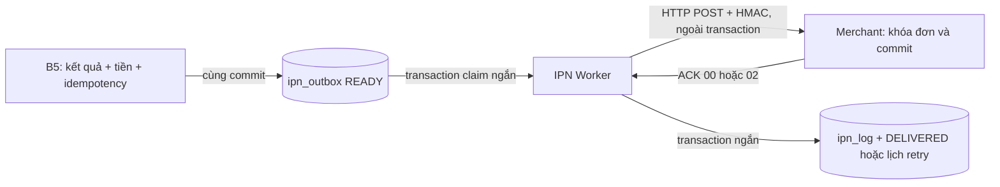
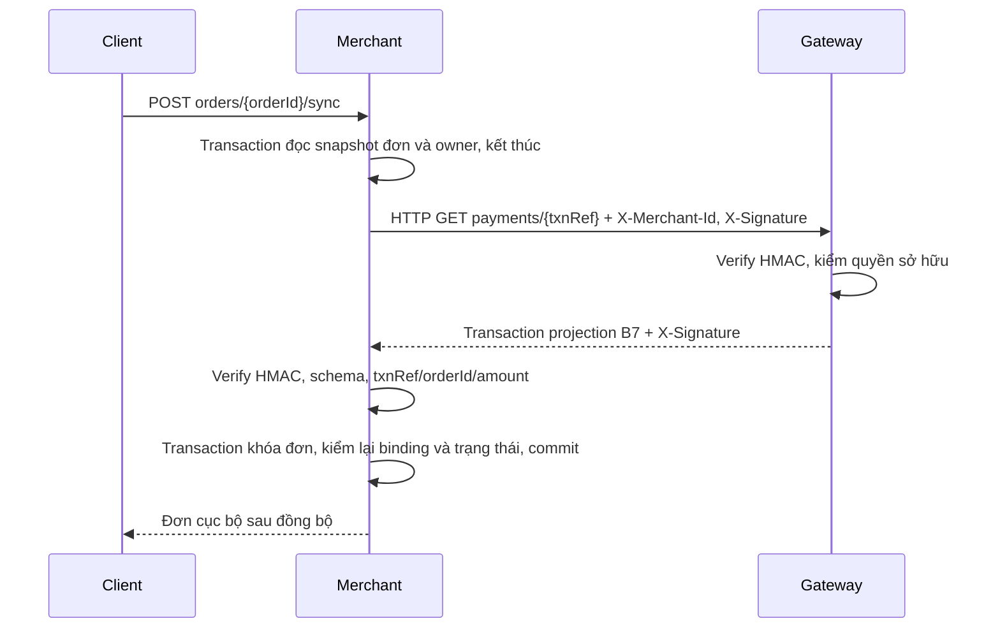
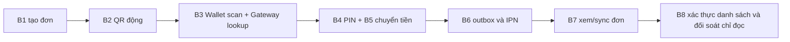

# QR Payment Flow — B1–B8

Ứng dụng bài tập Java 21, Spring Boot 3.5.16, Maven 3.9.16, H2.
Đã triển khai **B1–B8**: tạo đơn, QR động, scan, PIN, chuyển tiền giả lập, IPN bền
vững, tra cứu/đồng bộ, hết hạn và đối soát cuối ngày. Phần cộng điểm bổ sung đối soát CSV
và hoàn tiền toàn phần hoặc một phần.

- [Đề bài chính thức](bai-tap-luong-thanh-toan-qr.md)
- [Phân tích B1–B8, mô hình dữ liệu, transaction và các quyết định](docs/architecture.md)
- [Request chạy thử B1](requests/b1.http)
- [Báo cáo giai đoạn 1 và kết quả kiểm chứng thực tế](docs/phase1-report.md)
- [Báo cáo B2, quyết định kỹ thuật và kết quả kiểm chứng](docs/phase2-report.md)
- [Request B2](requests/b2.http)
- [Báo cáo B3 và thiết kế quyền GET dùng chung](docs/phase3-report.md)
- [Request B3](requests/b3.http)
- [Thiết kế B4–B5](docs/b4-b5-design.md), [báo cáo mốc B4](docs/phase4-report.md)
- [Báo cáo B5: transaction, concurrency, test và restart](docs/phase5-report.md)
- [Request B4–B5](requests/b4-b5.http)
- [Báo cáo B6: outbox, retry và phục hồi crash](docs/phase6-report.md)
- [Request B6](requests/b6.http)
- [Báo cáo B7: tra cứu, hết hạn và audit](docs/phase7-report.md)
- [Request B7](requests/b7.http)
- [Báo cáo B8 và trạng thái 12 kịch bản bắt buộc](docs/phase8-report.md)
- [Request B8](requests/b8.http), [demo HTTP toàn luồng B1–B8](requests/full-flow.http)

## Cấu trúc

```text
.mvn/wrapper/maven-wrapper.properties   Maven và checksum cố định
mvnw / mvnw.cmd                       Wrapper chính thức Apache
pom.xml
src/main/java/vn/vnpay/qr/
  QrPaymentApplication.java
  common/config/                      Clock, RestClient builder, JSON strict
  common/time/                        Khoảng ngày Việt Nam [start, end)
  common/crypto/                      Canonicalization và HMAC-SHA256
  common/qr/                          CRC dùng chung
  common/error/                       Error envelope và advice
  merchant/
    api/                              Controller và request/response DTO
    client/                           RestClient và DTO riêng phía Merchant
    config/                           MC001, URL và secret Gateway cục bộ
    domain/                           Order, OrderStatus
    repository/                       JPA repository, sequence cấp orderId
    service/                          B1/B2/B7/IPN; B8 so sánh snapshot chỉ đọc bằng Map
  gateway/
    api/                              POST payments, confirm; GET có phân quyền
    bank/                             Account, ledger, Bank nội bộ cùng transaction
    ipn/                              Outbox, attempt log, claim/lease, RestClient, worker
    domain/                           Merchant registry, PaymentTxn, PaymentStatus
    repository/                       Các repository chỉ Gateway sử dụng
    service/                          Tạo/replay/confirm/lookup, expiry, danh sách SUCCESS B8
    qr/                               TLV động, CRC-16/CCITT-FALSE
  wallet/
    api/                              POST scan và DTO
    qr/                               Parser TLV, CRC, tách 62/05
    client/                           RestClient và DTO riêng của Wallet
    config/                           URL và credential đọc Gateway
    service/                          So amount, status và expireAt qua Clock
    domain/, repository/              Wallet User, BCrypt hash và khóa PIN bền vững
src/main/resources/
  application.yml
  application-dev.yml                 H2 file, H2 console local
  schema.sql                          orders, merchant, payment_txn, wallet_user,
                                      account, ledger_entry, idempotency, ipn_outbox,
                                      ipn_log, sequence
  data.sql                            Seed MC001 nếu chưa tồn tại
src/test/java/vn/vnpay/qr/
  ApplicationContextTest.java
  merchant/OrderApiIntegrationTest.java
  merchant/MerchantPaymentHttpIntegrationTest.java
  gateway/CryptoAndQrTest.java
  gateway/GatewayPaymentApiIntegrationTest.java
  gateway/QrParserCompatibilityIT.java Kiểm tra ngoài qua API qr-parser gốc
  gateway/ConfirmationIntegrationTest.java Money, concurrency, fault injection
  gateway/RestartPersistenceIT.java    Hai process thật, HTTP và H2 file qua restart
  gateway/IpnIntegrationTest.java      HMAC, HTTP, retry, concurrency và fault injection
  gateway/IpnRestartIT.java            Ba process thật: READY, mất ACK, thu hồi lease
  gateway/PaymentExpiryIntegrationTest.java Clock, race với confirm, rollback và replay
  gateway/PaymentExpirySchedulerTest.java Scheduler thật, interval cấu hình
  merchant/MerchantStatusHttpIntegrationTest.java HTTP lookup/sync, race IPN và audit
  merchant/ReconciliationHttpIntegrationTest.java B1–B8 thật, sai lệch và dữ liệu giả mạo
  gateway/ReconciliationHmacTest.java   Vector HMAC JSON lồng nhau và ngày Việt Nam
  wallet/PaymentQrParserTest.java
  wallet/WalletScanHttpIntegrationTest.java
  wallet/WalletPaymentHttpTest.java    PIN, counter, lock, HTTP timeout
src/test/resources/application-test.yml
docs/architecture.md
requests/b1.http
requests/b2.http
requests/b3.http
```

Merchant → Gateway hiện gọi qua HTTP thật, không import service/repository/entity
của nhau. Bank nằm trong Gateway và dùng chung transaction cơ sở dữ liệu ở B5;
đã có Bank nội bộ, account, ledger, wallet_user và IPN qua HTTP tới Merchant.

## Chạy

Cần JDK 21, JAVA_HOME trỏ đến JDK và kết nối Maven Central cho lần tải đầu.
Không cần cài Maven riêng. Nếu chưa có JAVA_HOME trong PowerShell:

```powershell
$env:JAVA_HOME = Split-Path (Split-Path (Get-Command java).Source)
.\mvnw.cmd spring-boot:run
```

Linux/macOS:

```bash
sh mvnw spring-boot:run
```

API: `http://localhost:8080`. Mặc định profile `dev`, chỉ bind 127.0.0.1 cho bài tập.
H2 giữ dữ liệu qua lần khởi động ở `data/qr-payment.mv.db`, không ghi file này vào Git.
`WRITE_DELAY=0` yêu cầu H2 đồng bộ ghi file khi commit, tránh cửa sổ mất commit do
chế độ ghi trễ mặc định nếu tiến trình bị dừng đột ngột ngay sau phản hồi 201.
H2 console: `http://localhost:8080/h2-console`, JDBC URL
`jdbc:h2:file:./data/qr-payment`, user `sa`, password mặc định rỗng cho dev local.
Có thể đặt `QR_DB_PASSWORD` trước lần tạo DB đầu tiên. Không bật console cho truy cập từ xa.

Merchant dùng `QR_GATEWAY_BASE_URL` (mặc định `http://localhost:${server.port}`) và
`QR_MERCHANT_SECRET` (mặc định secret giả lập `secret-mc001`). Registry MC001 có secret
mẫu theo đề; khi thay secret cần cập nhật cả hai phía. Seed chỉ insert khi thiếu,
không ghi đè registry đã có. Với `server.port=0`, cấu hình URL Gateway rõ ràng sau khi
biết cổng thật; dev thông thường dùng cổng cố định 8080.

## API B1

`POST /api/merchant/orders`, `Content-Type: application/json`

```json
{"amount":55000,"description":"Thanh toan ao thun"}
```

`201 Created` (orderId và createdAt phụ thuộc lần chạy):

```json
{
  "orderId":"ORD20261109001",
  "merchantId":"MC001",
  "amount":55000,
  "description":"Thanh toan ao thun",
  "status":"CREATED",
  "createdAt":"2026-11-09T09:00:00+07:00"
}
```

PowerShell:

```powershell
Invoke-RestMethod -Method Post -Uri http://localhost:8080/api/merchant/orders `
  -ContentType application/json `
  -Body '{"amount":55000,"description":"Thanh toan ao thun"}'
```

Linux/macOS:

```bash
curl -i http://localhost:8080/api/merchant/orders \
  -H 'Content-Type: application/json' \
  -d '{"amount":55000,"description":"Thanh toan ao thun"}'
```

| Trường hợp | HTTP / mã |
|---|---|
| amount là số nguyên JSON từ 1.000 đến 500.000.000, description hợp lệ | 201 |
| Thiếu/null amount, sai kiểu, số thực, chuỗi số, overflow, ngoài khoảng | 400 INVALID_AMOUNT |
| Thiếu/null description, rỗng/blank, >19, dấu/ký tự lạ, sai kiểu | 400 INVALID_DESCRIPTION |
| Body JSON hỏng, rỗng, không phải object, duplicate key, trailing token | 400 INVALID_REQUEST |
| Lỗi server bất ngờ | 500 INTERNAL_ERROR |

Mô tả chỉ gồm `[A-Za-z0-9 ]`, không tự trim. Ví dụ gốc
`Thanh toan don hang ao thun` dài hơn 19 ký tự nên **phải bị từ chối**.
Error response luôn có ba trường:

```json
{"errorCode":"INVALID_AMOUNT","message":"amount must be an integer between 1000 and 500000000 VND","timestamp":"2026-11-09T09:00:00+07:00"}
```

B1 chưa có khóa request phía client trong đề: hai POST giống nội dung tạo hai đơn
riêng, không tự retry B1 sau timeout. Không gộp đơn theo amount/description. Chi tiết
giới hạn idempotency này và kế hoạch B2/B5 ở tài liệu thiết kế. B1 không gọi Gateway
và không tạo QR. GET xem đơn và POST đồng bộ trạng thái được bổ sung riêng ở B7.

## API B2 và luồng Merchant → Gateway → Merchant

```mermaid
sequenceDiagram
    participant C as Client
    participant M as Merchant
    participant G as Gateway
    C->>M: POST /orders (B1)
    M-->>C: 201 CREATED + orderId
    C->>M: POST /orders/{orderId}/payments, expireMinutes
    M->>M: Đọc đơn trong transaction ngắn, kết thúc transaction
    M->>G: HTTP POST /api/gateway/payments + HMAC
    G->>G: Xác thực, tạo/replay payment_txn, commit
    G-->>M: 201 PENDING + QR, X-Signature
    M->>M: Verify response; transaction lưu txnRef + WAITING_PAYMENT
    M-->>C: 201 với cùng dữ liệu Gateway
```

### Kích hoạt từ Merchant

`POST /api/merchant/orders/{orderId}/payments`

```json
{"expireMinutes":15}
```

Chỉ nhận expireMinutes từ 1 đến 60. Amount, description và merchantId lấy từ đơn
đã lưu. Body có thêm amount/description hoặc trường lạ bị từ chối; không thay đổi B1.

PowerShell, sau khi ứng dụng đang chạy:

```powershell
$order = Invoke-RestMethod -Method Post -Uri http://localhost:8080/api/merchant/orders `
  -ContentType application/json -Body '{"amount":55000,"description":"Thanh toan ao thun"}'
$payment = Invoke-RestMethod -Method Post `
  -Uri "http://localhost:8080/api/merchant/orders/$($order.orderId)/payments" `
  -ContentType application/json -Body '{"expireMinutes":15}'
$payment
```

### API Gateway theo đề

`POST /api/gateway/payments`

```json
{
  "merchantId":"MC001",
  "orderId":"ORD20261102001",
  "amount":55000,
  "description":"Thanh toan ao thun",
  "expireMinutes":15,
  "signature":"bdda985548c27afd42ef3b29e6b868b767e1926e54ae52989e197321321e03ff"
}
```

Signature trên dành đúng body ví dụ và secret mẫu. Bỏ signature, sort key tăng dần,
nối `key=value` bằng `&`, giữ nguyên dấu cách, UTF-8 rồi HMAC-SHA256 lowercase hex.
Merchant tự tính chữ ký khi gọi endpoint kích hoạt phía trên.

Cả hai endpoint B2 trả **201 Created**, ví dụ minh họa với thời gian/sequence cố định:

```json
{
  "txnRef":"TX00000001",
  "orderId":"ORD20261102001",
  "amount":55000,
  "status":"PENDING",
  "expireAt":"2026-11-02T09:15:00+07:00",
  "qrString":"00020101021226230010A0000007750105MC0015204549953037045405550005802VN5908SHOP ABC6005HANOI62530522012611020915TX000000010818Thanh toan ao thun0901M6304C9E9"
}
```

Gateway thêm header `X-Signature` ký toàn bộ response JSON. Merchant phải verify trước
khi cập nhật đơn. Lỗi có body parse được và merchant đã đăng ký cũng được ký; lỗi
JSON chưa parse được hoặc merchant không tồn tại không thể ký bằng secret của merchant.
Merchant coi response thiếu/sai chữ ký là không đáng tin và không cập nhật đơn.

| Tình huống B2 | HTTP / mã hoặc hành vi |
|---|---|
| Đúng request | 201, PENDING, txnRef/QR/hạn thanh toán |
| Cùng merchantId/orderId và amount | 201, trả nguyên giao dịch cũ, không đổi QR/hạn |
| Cùng merchantId/orderId, khác amount | 409 ORDER_CONFLICT |
| Merchant chưa đăng ký | 404 MERCHANT_NOT_FOUND tại Gateway |
| Signature thiếu/sai | 401 INVALID_SIGNATURE |
| Amount/description sai | 400 INVALID_AMOUNT / INVALID_DESCRIPTION |
| expireMinutes thiếu/sai kiểu/ngoài 1–60 | 400 INVALID_EXPIRE_MINUTES |
| Identifier hoặc trường lạ không hợp lệ | 400 INVALID_REQUEST |
| Không tìm thấy đơn phía Merchant | 404 ORDER_NOT_FOUND |
| Mất kết nối/không biết Gateway đã commit chưa | Merchant trả 502 GATEWAY_UNAVAILABLE |
| Response Gateway hỏng, thiếu/sai HMAC hoặc không khớp đơn | Merchant trả 502 INVALID_GATEWAY_RESPONSE |

Nếu Gateway đã commit nhưng Merchant mất response hoặc lưu đơn thất bại, gọi lại
**endpoint payments với cùng orderId**. Gateway trả txnRef cũ và Merchant cập nhật lại
trong transaction ngắn. Không tạo lại B1 để retry B2. Thay description/expireMinutes
của request replay không cập nhật giao dịch cũ. Job B7 xử lý hết hạn; replay B2
không gia hạn hoặc tự tạo giao dịch mới. Tra cứu giao dịch terminal bằng B7.

## API B3 — Wallet quét QR

`POST /api/wallet/scan`

```json
{"userId":"U001","qrString":"<chuỗi qrString trả về từ B2>"}
```

PowerShell, tiếp theo biến `$payment` ở ví dụ B2:

```powershell
$scan = Invoke-RestMethod -Method Post -Uri http://localhost:8080/api/wallet/scan `
  -ContentType application/json `
  -Body (@{userId='U001'; qrString=$payment.qrString} | ConvertTo-Json)
$scan
```

200 OK, ví dụ (hạn thanh toán thực tế lấy từ Gateway):

```json
{
  "txnRef":"TX00000001",
  "merchantName":"SHOP ABC",
  "merchantCity":"HANOI",
  "amount":55000,
  "currency":"VND",
  "description":"Thanh toan ao thun",
  "expireAt":"2026-11-12T09:15:00+07:00"
}
```

Wallet parse TLV/required tags và CRC trước khi gọi HTTP; lấy txnRef sau prefix 01
và 10 ký tự thời hạn của 62/05. Mọi trường hiển thị lấy từ Gateway, chỉ amount QR
được dùng để đối chiếu. Hạn trong QR không quyết định hết hạn. B3 không ghi DB.

| Trường hợp | HTTP / mã |
|---|---|
| TLV hỏng, thiếu/duplicate tag, sai 62/05, QR trống | 422 INVALID_QR |
| CRC khác CRC tính lại | 422 CRC_MISMATCH |
| Amount QR khác amount Gateway | 422 AMOUNT_MISMATCH |
| Giao dịch không có | 404 TXN_NOT_FOUND |
| Trạng thái terminal hoặc PROCESSING | 422 TXN_NOT_PAYABLE |
| EXPIRED hoặc PENDING đến/quá expireAt của Gateway | 422 TXN_EXPIRED |
| HTTP Gateway mất kết nối/5xx | 502 GATEWAY_UNAVAILABLE |
| Response Gateway hỏng/sai chữ ký/không khớp txnRef | 502 INVALID_GATEWAY_RESPONSE |

Lỗi đều có errorCode/message/timestamp. Chọn TXN_EXPIRED theo bảng mã và thiết kế
đã duyệt vì mô tả B3 có chỗ dùng TXN_NOT_PAYABLE cho cả hết hạn. userId chỉ là ngữ
cảnh bắt buộc; chưa xác thực người dùng, PIN hay nạp wallet_user ở B3.

### GET Gateway dùng chung cho Wallet và Merchant

`GET /api/gateway/payments/{txnRef}` không cho truy cập ẩn danh:

- **Wallet:** `Authorization: Bearer <read-token>`. Chỉ trả txnRef, merchantName,
  merchantCity, amount, currency, description, status, expireAt; không orderId,
  bankRef hoặc tài khoản. Token riêng của Wallet, không phải secret Merchant.
- **Merchant:** cặp `X-Merchant-Id` / `X-Signature` bắt buộc. Chuỗi ký GET:
  `merchantId=MC001&txnRef=TX00000001`. Chỉ đọc giao dịch thuộc merchant đã xác
  thực; response gồm các trường B7 theo đề, bỏ bankRef/paidAt nếu chưa có.
- Có bất kỳ header Merchant nào là bắt buộc đi nhánh HMAC. Thiếu/sai/duplicate
  header hoặc trộn với Authorization đều bị từ chối, không fallback sang Wallet.
- Response sau xác thực (kể cả 404) có `X-Signature` HMAC trên JSON và
  `Cache-Control: no-store`: dùng secret Merchant hoặc read-token Wallet tương ứng.
  Wallet verify signature và txnRef trước khi dùng response.

Cấu hình `QR_WALLET_READ_TOKEN` ở hai phía (mẫu dev local mặc định
`wallet-read-token-dev-only`); `QR_GATEWAY_BASE_URL` dùng như B2. Token không nhận từ
body scan và không nằm trong QR. B7 tái sử dụng nguyên GET có phân quyền này cho
Merchant; không mở thêm projection Merchant cho credential Wallet.

## API B4–B5 — Thanh toán

`POST /api/wallet/payments`:

```json
{
  "userId":"U001",
  "txnRef":"TX00000001",
  "amount":55000,
  "pin":"123456",
  "requestId":"4f1c2a9e-7b3d-4c55-9a10-0e2b6f8d1a77"
}
```

Wallet kiểm BCrypt, lấy payerAccount từ user, rồi gọi HTTP
`POST /api/gateway/payments/{txnRef}/confirm` với body đúng hợp đồng:

```json
{"payerAccount":"1000001","amount":55000,"requestId":"4f1c2a9e-7b3d-4c55-9a10-0e2b6f8d1a77"}
```

Confirm bắt buộc `X-Wallet-Signature`: HMAC-SHA256 của các trường body cộng txnRef
trong path, sort key và nối bằng &. Dùng secret riêng `QR_WALLET_PAYMENT_SECRET`
(mẫu local `wallet-payment-secret-dev-only`), **không dùng token đọc B3**. PIN không
gửi sang Gateway; client không thể thêm payerAccount vào request Wallet.

200 SUCCESS (ví dụ):

```json
{
  "txnRef":"TX00000001","status":"SUCCESS","amount":55000,
  "bankRef":"BK20261112000001","paidAt":"2026-11-12T09:03:12+07:00",
  "message":"Thanh toán thành công"
}
```

Thiếu tiền trả 200 với status FAILED, amount, errorCode INSUFFICIENT_FUNDS và
message; không bankRef/paidAt, không thay đổi số dư hoặc tạo ledger.

| Trường hợp | HTTP / mã |
|---|---|
| PIN sai | 401 INVALID_PIN |
| Lần sai thứ ba và trong 15 phút khóa | 423 PIN_LOCKED |
| User không có | 404 WALLET_USER_NOT_FOUND |
| Confirm thiếu/sai credential thanh toán | 401 INVALID_WALLET_CREDENTIALS |
| Giao dịch không tồn tại | 404 TXN_NOT_FOUND |
| Không còn PENDING | 422 TXN_NOT_PAYABLE |
| PENDING đến/quá hạn, hoặc đã EXPIRED | 422 TXN_EXPIRED, lưu EXPIRED |
| Amount khác DB | 422 AMOUNT_MISMATCH |
| Account nguồn/đích không có | 404 ACCOUNT_NOT_FOUND, payment FAILED |
| Account nguồn trùng đích | 422 INVALID_TRANSFER, payment giữ PENDING |
| Cùng UUID nhưng khác txnRef/account/amount | 409 IDEMPOTENCY_CONFLICT |
| Wallet timeout/kết nối/5xx/response không xác thực | 502 PAYMENT_RESULT_UNKNOWN |

Với kết quả UNKNOWN, **giữ nguyên requestId/txnRef/amount để retry**; không tạo UUID
mới và không kết luận FAILED. Gateway lưu status HTTP và body response cùng transaction
tiền; replay không tạo bankRef/ledger mới. Không có auto retry vô hạn trong Wallet.

Seed U001/PIN 123456/số dư 1.000.000; U002/PIN mẫu 123456/số dư 10.000;
merchant account 9000001/số dư 0. PIN chỉ lưu BCrypt strength 10. Seed chỉ thêm khi
thiếu, không reset số dư hoặc lock khi restart. PIN đúng reset counter; mỗi lần xác
thực PIN sai được đếm, kể cả requestId được lặp, để không cho thử PIN vô hạn bằng
cách tái sử dụng UUID. Khóa/bộ đếm commit trước khi trả lỗi và trước HTTP Gateway.

Gateway khóa payment_txn và hai account theo thứ tự account_no cố định. Bank dùng
propagation MANDATORY, cùng transaction JPA; debit, credit, hai ledger và cache kết
quả hoặc commit tất cả, hoặc rollback tất cả. Lỗi hệ thống không được đổi thành
thành công/thiếu tiền. B5 commit thêm outbox; worker B6 cập nhật Merchant sau commit.

## API B6 — IPN tới Merchant

Sau khi B5 commit SUCCESS hoặc FAILED, Gateway tự gửi
`POST {merchant.ipn_url}` bằng RestClient. URL mẫu MC001 là
`http://localhost:8080/api/merchant/ipn`. Nếu đổi cổng, cập nhật registry trước khi
thanh toán; URL và payload đã tạo trong outbox được giữ cố định khi retry.



Ví dụ body SUCCESS (signature phải được tính từ toàn bộ trường còn lại):

```json
{
  "txnRef":"TX00000001","orderId":"ORD20261102001","amount":55000,
  "status":"SUCCESS","bankRef":"BK20261102000001",
  "paidAt":"2026-11-02T09:03:12+07:00","signature":"<hex HMAC-SHA256>"
}
```

FAILED chỉ có txnRef/orderId/amount/status/signature; bỏ bankRef/paidAt.
HMAC dùng secret Merchant, UTF-8, bỏ signature và giá trị null, sort key tăng dần,
nối `key=value` bằng `&`, giữ nguyên format paidAt và không URL-encode, như B2.
Merchant dùng secret cấu hình cục bộ; không nhận secret hoặc merchantId tùy ý từ IPN.

| HTTP 200 / code | Ý nghĩa |
|---|---|
| `97` / Invalid signature | Sai hoặc thiếu HMAC, ưu tiên trước kiểm đơn |
| `01` / Order not found | Đơn không thuộc Merchant hoặc txnRef không khớp đơn |
| `04` / Invalid amount | Amount không khớp đơn |
| `02` / Order already confirmed | Đơn đã ra khỏi WAITING_PAYMENT; không thay đổi |
| `00` / Confirm success | SUCCESS → PAID; FAILED → PAYMENT_FAILED |

Response đúng hai trường, ví dụ `{"code":"00","message":"Confirm success"}`.
Merchant khóa đơn trong transaction; replay trả 02 và IPN mâu thuẫn không đảo PAID.
JSON hỏng hoặc payload có chữ ký đúng nhưng status/paidAt/bankRef sai cấu trúc trả
400 INVALID_REQUEST theo error envelope kỹ thuật hiện có.

Worker poll mặc định 1s, gửi tối đa **3 lần tổng cộng**: lần đầu ngay khi claim,
lần hai sau 10s kể từ kết thúc lần trước, lần ba sau thêm 30s. Không gửi lần thứ tư.
HTTP timeout/connect error, non-2xx, JSON lỗi hoặc code khác 00/02 đều retry;
00/02 trên HTTP 2xx kết thúc. RestClient connect 3s/read 5s, không follow redirect.
Mỗi attempt được reserve cùng log trước HTTP; lease mặc định 60s, token ngăn ACK cũ
ghi đè công việc đã thu hồi. Hết budget giữ EXHAUSTED, không hoàn tiền/chuyển lại tiền.

Cấu hình tùy chọn (giá trị mặc định nằm trong `IpnProperties`):

```yaml
app:
  gateway:
    ipn:
      enabled: true
      poll-millis: 1000
      lease: PT1M
      second-delay: PT10S
      third-delay: PT30S
```

Lease tối thiểu 15s. Test mặc định tắt scheduler để các ca B1–B5 giữ fixture cũ;
test B6 gọi worker thật với Clock điều khiển được, và IT bật scheduler qua restart.
Không thêm broker hoặc API kích hoạt worker. Chạy B1 → B2 → Wallet payments như ví dụ
trên là đủ để phát sinh IPN; xem outbox/log/orders qua H2 console dev.
Từ B7, `ipn_log.request_body` bỏ trường signature; `ipn_outbox.request_body` vẫn
giữ nguyên payload đã ký. Khi khởi động, ứng dụng cũng xóa chữ ký khỏi log B6 cũ,
giữ nguyên ID, attempt, outcome và timestamps, không sửa dữ liệu tài chính.

## API B7 — tra cứu, đồng bộ và hết hạn

`GET /api/merchant/orders/{orderId}` chỉ đọc đơn cục bộ, không gọi Gateway hay ghi DB.
Ví dụ HTTP 200 (các ID/thời gian chỉ minh họa):

```json
{
  "orderId":"ORD20261113001","merchantId":"MC001","amount":55000,
  "description":"Ao thun","status":"PAID","txnRef":"TX00000001",
  "createdAt":"2026-11-13T10:00:00+07:00","paidAt":"2026-11-13T10:00:30+07:00"
}
```

CREATED chưa có txnRef, các trạng thái chưa thanh toán không có paidAt.

`POST /api/merchant/orders/{orderId}/sync`, không cần body, chủ động hỏi Gateway
khi đơn WAITING_PAYMENT. HTTP 200 trả cùng cấu trúc GET với trạng thái đã đồng bộ.
POST thể hiện việc có thể ghi trạng thái; GET giữ đúng tính chất chỉ đọc.



Gateway GET giữ nguyên từ B3: chữ ký request ký `merchantId` + `txnRef`; Merchant
nhận txnRef/orderId/amount/status/createdAt và bankRef/paidAt nếu có, Wallet vẫn chỉ
nhận projection xác nhận tám trường. Mọi response lookup đã xác thực được ký trong
`X-Signature` và có `Cache-Control: no-store`. Không thêm merchantId vào response B7.
Quyền sở hữu được kiểm ở Gateway theo credential Merchant và ở Merchant theo đơn
cục bộ, kết hợp kiểm binding txnRef/orderId/amount sau xác thực response.

Sync chỉ chuyển WAITING_PAYMENT theo trạng thái Gateway: SUCCESS → PAID,
FAILED → PAYMENT_FAILED, EXPIRED → EXPIRED. PENDING/PROCESSING giữ nguyên; CREATED
hoặc các trạng thái terminal là no-op cục bộ. IPN và sync dùng cùng khóa dòng Order;
kết quả HTTP cũ không ghi đè đơn đã được IPN xử lý. Không suy ra EXPIRED từ Clock
cục bộ, cũng không suy ra FAILED từ timeout. Có thể gọi lại sync sau lỗi mạng/lỗi lưu.

| Trường hợp B7 | HTTP / mã |
|---|---|
| Không có đơn hoặc đơn thuộc Merchant khác | 404 ORDER_NOT_FOUND |
| Gateway trả TXN_NOT_FOUND có HMAC hợp lệ | 404 TXN_NOT_FOUND, giữ nguyên đơn |
| Không nhận phản hồi, timeout headers/body hoặc HTTP 5xx | 502 GATEWAY_UNAVAILABLE |
| Sai/thiếu HMAC, schema hoặc txnRef/orderId/amount không khớp | 502 INVALID_GATEWAY_RESPONSE |
| Binding đơn thay đổi giữa đọc và cập nhật | 409 ORDER_CONFLICT |

Lookup dùng RestClient connect 3s/read 5s kể cả đọc body, không follow redirect,
giới hạn response 16 KiB. Factory HTTP được tái sử dụng từ IPN; không đổi transport B2.

Job Gateway chạy ngay khi scheduler sẵn sàng và sau mỗi **60.000ms** kể từ lần chạy
trước kết thúc. Cấu hình `app.gateway.expiry.enabled` (mặc định true) và
`app.gateway.expiry.interval-millis` (mặc định 60000). Test profile tắt job để điều
khiển Clock; test scheduler riêng bật interval 25ms và không gọi job thủ công.
Hai luồng scheduler giúp việc gửi IPN không chiếm hết lịch chạy job hết hạn.

Job chỉ chuyển PENDING có `expireAt <= Clock.instant()` sang EXPIRED, khóa cùng
payment_txn như B5 và kiểm lại sau khi lấy khóa. Confirm kiểm hợp lệ trước hạn có
thể hoàn tất SUCCESS sau hạn; job chờ khóa rồi giữ nguyên SUCCESS. Confirm lấy khóa
tại/sau hạn bị từ chối. Không chuyển tiền, thêm ledger, idempotency hoặc IPN cho EXPIRED.
Index `(status, expire_at)` hỗ trợ tìm ứng viên; mỗi giao dịch dùng transaction ngắn riêng.

## API B8 — đối soát cuối ngày

Gateway: `GET /api/gateway/reconciliation?merchantId=MC001&date=2026-11-02`.
Header bắt buộc `X-Merchant-Id: MC001`, `X-Signature` ký hai trường date + merchantId.
Header Merchant phải khớp query, không cho dùng credential Wallet hoặc trộn credential.
Response có X-Signature và no-store, chỉ chứa năm trường theo đề:

```json
{
  "merchantId":"MC001","date":"2026-11-02","successCount":1,"successAmount":55000,
  "transactions":[{"txnRef":"TX00000001","orderId":"ORD20261102001","amount":55000,
    "status":"SUCCESS","bankRef":"BK20261102000001","paidAt":"2026-11-02T09:03:12+07:00"}]
}
```

Merchant: `POST /api/merchant/reconcile`, body `{"date":"2026-11-02"}`. Merchant tự
gọi Gateway qua HTTP và xác thực HMAC/schema trước khi đối chiếu snapshot local.
HTTP 200 với đúng bảy trường, ví dụ một giao dịch mất IPN:

```json
{
  "date":"2026-11-02","matched":0,
  "missingInMerchant":[{"txnRef":"TX00000001","orderId":"ORD20261102001","amount":55000}],
  "missingInGateway":[],"amountMismatch":[],"gatewayTotal":55000,"merchantTotal":0
}
```

Ngày tính theo **paidAt tại Asia/Ho_Chi_Minh**, từ đầu ngày đến trước đầu ngày sau.
Gateway lọc SUCCESS, Merchant lọc PAID trong cùng khoảng; không lấy createdAt hoặc
ngày UTC. So sánh bằng Map theo txnRef, kiểm cả orderId; không so hai danh sách lồng nhau.
Matched yêu cầu hai bên cùng thành công và amount bằng nhau. Có cả hai nhưng lệch
amount chỉ vào `amountMismatch`, dạng `{txnRef,orderId,gatewayAmount,merchantAmount}`.
Totals cộng toàn bộ amount của từng tập riêng bằng long, không chỉ các dòng matched.

HMAC giữ nguyên quy tắc scalar B2. Với array/object B8, value là JSON compact, sort
key object đệ quy, giữ thứ tự array; Gateway sort transactions theo txnRef. Không
URL-encode hoặc chuẩn hóa paidAt trước verify. Client kiểm merchant/date, toàn bộ
schema, định danh, SUCCESS, paidAt đúng ngày, uniqueness txnRef/orderId/bankRef và
đối chiếu count/total; payload đúng chữ ký vẫn phải vượt các kiểm tra này.

Đối soát **không ghi đơn hoặc tài chính**, không tự sync. Với missingInMerchant,
có thể gọi POST sync B7 riêng rồi chạy lại báo cáo. Hai snapshot lấy qua HTTP/DB
khác thời điểm; nếu đang có thanh toán/IPN, chạy lại sau khi các giao dịch ổn định.

| Lỗi B8 | HTTP / mã |
|---|---|
| Ngày không đúng yyyy-MM-dd/ngày lịch không tồn tại | 400 INVALID_DATE |
| JSON sai kiểu, trường lạ, query thiếu/trùng/thừa | 400 INVALID_REQUEST |
| Gateway thiếu/sai HMAC, header/query khác Merchant, credential không hợp lệ | 401 INVALID_SIGNATURE |
| Gateway mất phản hồi/timeout headers hoặc body/5xx | 502 GATEWAY_UNAVAILABLE tại Merchant |
| Response sai HMAC/schema/binding/count/total hoặc trùng giao dịch | 502 INVALID_GATEWAY_RESPONSE |
| Đơn PAID thiếu txnRef/paidAt hợp lệ, không thể đối soát an toàn | 409 INVALID_MERCHANT_DATA |

Không có báo cáo thành công giả khi Gateway lỗi. HTTP client dùng timeout 3s/5s,
không redirect, giới hạn response B8 4 MiB và từ chối thay vì trả danh sách bị cắt.
Chưa phân trang; các index mới hỗ trợ merchant/status/paid_at. Chi tiết giả định,
schema và ví dụ các loại lệch trong [báo cáo B8](docs/phase8-report.md).

## Demo B1–B8

Mở [requests/full-flow.http](requests/full-flow.http) bằng VS Code REST Client,
chạy tuần tự từng request có tên. File tự nối orderId, txnRef, QR từ response trước.
Đặt date theo ngày thanh toán Việt Nam; đổi requestId cho một lần mua mới và giữ
nguyên nếu retry. B6 chạy nền, chờ khoảng một giây rồi GET đơn; B7 sync là thao tác
riêng khi mất IPN. Báo cáo tính tất cả giao dịch cùng ngày, nên matched có thể lớn
hơn 1 nếu DB đã có các lần demo trước. Các request từng bước vẫn nằm trong requests/.



## Cộng điểm — đối soát qua CSV

Gateway xuất danh sách giao dịch thành công thành file CSV có chữ ký.
Merchant nhận file và đối soát với các đơn `PAID` đã lưu. Kết quả có cùng bảy trường
như B8. Có thể nhập file đã tải khi Gateway tạm ngừng hoạt động.

| Thao tác | Request |
|---|---|
| Tải CSV đã ký | `GET /api/gateway/reconciliation/csv?merchantId=MC001&date=2026-11-19` cùng `X-Merchant-Id` và `X-Signature` như B8 |
| Nhập CSV và xem báo cáo | `POST /api/merchant/reconcile/csv?date=2026-11-19` với `Content-Type: text/csv` và nguyên file trong body |

Chạy demo B1–B7 trước để có giao dịch `PAID`. Mở PowerShell và đặt `$qrDate` theo ngày
`paidAt` tại Việt Nam. Ví dụ dưới đây dùng khóa của cửa hàng mẫu `MC001`.

```powershell
$qrDate = '2026-11-19'
$qrMerchant = 'MC001'
$qrFile = Join-Path ([IO.Path]::GetTempPath()) "qr-payment-$qrDate.csv"
$qrHmac = [System.Security.Cryptography.HMACSHA256]::new([Text.Encoding]::UTF8.GetBytes('secret-mc001'))
try {
    $qrHash = $qrHmac.ComputeHash([Text.Encoding]::UTF8.GetBytes("date=$qrDate&merchantId=$qrMerchant"))
    $qrSignature = [BitConverter]::ToString($qrHash).Replace('-', '').ToLowerInvariant()
} finally {
    $qrHmac.Dispose()
}

curl.exe --fail-with-body -sS `
    -H "X-Merchant-Id: $qrMerchant" -H "X-Signature: $qrSignature" `
    -o $qrFile "http://localhost:8080/api/gateway/reconciliation/csv?merchantId=$qrMerchant&date=$qrDate"
if ($LASTEXITCODE -ne 0) { throw 'Tai CSV that bai' }

curl.exe --fail-with-body -sS -H "Content-Type: text/csv" `
    --data-binary "@$qrFile" "http://localhost:8080/api/merchant/reconcile/csv?date=$qrDate"
```

File UTF-8 có dòng `SUMMARY` ghi mã cửa hàng, ngày, tổng và chữ ký. Mỗi giao dịch
thành công có một dòng `PAYMENT`. Gửi nguyên file xuất từ Gateway. Merchant từ chối
file sai chữ ký, sai ngày, sai cửa hàng hoặc sai cấu trúc với `400 INVALID_CSV`.
Giới hạn mỗi file là 4 MiB. Báo cáo chỉ đọc dữ liệu và có thể chạy lại với cùng file.

## Cộng điểm — hoàn tiền

Sau khi khách trả 55.000đ, cửa hàng có thể hoàn 20.000đ rồi hoàn tiếp 35.000đ.
Gateway chuyển ngược tiền giữa hai tài khoản của giao dịch gốc và ghi sổ riêng cho
mỗi lần hoàn. `PARTIALLY_REFUNDED` trong kết quả nghĩa là vẫn còn tiền có thể hoàn.
Khi hoàn hết, trạng thái Gateway là `REFUNDED`. Tổng hoàn tối đa bằng số tiền đã thu.

`POST /api/gateway/payments/{txnRef}/refund` nhận JSON `amount` (số nguyên VND dương)
và `requestId` (UUID). Dùng `X-Merchant-Id` và `X-Signature` HMAC-SHA256 cho chuỗi
`action=refund&amount=<amount>&merchantId=<id>&requestId=<uuid>&txnRef=<ref>`.
Cửa hàng phải sở hữu giao dịch. Thành công trả HTTP 200 và `X-Signature` cùng các trường
`txnRef`, `refundRef`, `requestId`, `amount`, `totalRefunded`, `remainingAmount`, `status`,
`refundedAt`. Gửi lại cùng `txnRef`, `requestId` và `amount` trả kết quả của lần đó.
Đổi số tiền với cùng UUID trả `409 IDEMPOTENCY_CONFLICT`, còn vượt số tiền có thể hoàn
trả `422 REFUND_AMOUNT_EXCEEDED`. Tài khoản cửa hàng thiếu tiền thì trả
`422 INSUFFICIENT_FUNDS` và có thể gửi lại sau khi có đủ số dư.

Demo bằng PowerShell sau khi đã tạo một giao dịch mẫu thành công 55.000đ:

```powershell
function Invoke-QrRefund($qrRef, $qrAmount, $qrRequestId) {
    $qrData = "action=refund&amount=$qrAmount&merchantId=MC001&requestId=$qrRequestId&txnRef=$qrRef"
    $qrHmac = [Security.Cryptography.HMACSHA256]::new([Text.Encoding]::UTF8.GetBytes('secret-mc001'))
    try {
        $qrSignature = [BitConverter]::ToString($qrHmac.ComputeHash([Text.Encoding]::UTF8.GetBytes($qrData))).Replace('-', '').ToLowerInvariant()
    } finally { $qrHmac.Dispose() }
    Invoke-RestMethod -Method Post -Uri "http://localhost:8080/api/gateway/payments/$qrRef/refund" `
      -ContentType 'application/json' -Headers @{'X-Merchant-Id'='MC001'; 'X-Signature'=$qrSignature} `
      -Body (@{amount=$qrAmount; requestId=$qrRequestId} | ConvertTo-Json -Compress)
}

$qrRef = 'TX00000002' # Thay bằng txnRef vừa thanh toán nếu dùng giao dịch khác.
$qrPartialId = [guid]::NewGuid().ToString()
Invoke-QrRefund $qrRef 20000 $qrPartialId
Invoke-QrRefund $qrRef 20000 $qrPartialId # Gửi lại, cùng refundRef.
Invoke-QrRefund $qrRef 35000 ([guid]::NewGuid().ToString())
```

B8 và CSV đối soát **số tiền thu ban đầu** theo ngày `paidAt`, kể cả giao dịch đã
hoàn hết. Merchant giữ `PAID` để ghi nhận lần thu ban đầu. Hoàn tiền có lịch sử riêng
trong `refund_txn` / `refund_ledger_entry`. Báo cáo doanh thu ròng sẽ cần trừ phần hoàn
theo quy tắc kế toán của hệ thống sử dụng báo cáo.

## Kiểm thử

```powershell
.\mvnw.cmd test
```

```bash
sh mvnw test
```

Test tự chọn profile `test`, dùng H2 memory riêng và fixed Clock khi kiểm thời gian.
Không bọc test HTTP trong transaction. Test B2 có Gateway HTTP thật và proxy thử lỗi
để kiểm mất response sau commit, lỗi lưu Merchant, response hỏng và concurrency.
Kiểm tra qr-parser ngoài được tách thành
`QrParserCompatibilityIT`, phải khởi động project gốc để chạy, không âm thầm skip.

Kiểm tra Type04 bằng project gốc trong terminal khác, từ thư mục qr-parser chứa pom.xml:

```powershell
.\mvnw.cmd package
java -jar target/qr-parser-0.0.1-SNAPSHOT.jar --server.port=8081
```

Tại qr-payment-flow, chạy **toàn bộ B1–B8, Type04 và restart thật** bằng profile chuẩn:

```powershell
.\mvnw.cmd -Pfull-suite "-Dqr.parser.url=http://localhost:8081" verify
```

Linux/macOS dùng `sh mvnw -Pfull-suite -Dqr.parser.url=http://localhost:8081 verify`.
Dependency ngoài ứng dụng: JDK 21, Maven Central lần tải đầu, project qr-parser gốc
đang chạy tại URL được chỉ định. Restart tests tự tạo process/port/H2 file trong target/.
Không có parser thật thì full-suite thất bại; không dùng mock hoặc âm thầm skip.

Kết quả thực tế ngày 2026-11-19 là **386 PASS, 0 FAIL, 0 errors, 0 skipped**.
Bộ này gồm 377 test B1–B8 và 9 test đối soát CSV.
`mvnw test` mặc định chọn 383 test nội bộ. Profile full-suite thêm ba lớp IT.
`qr-parser`
gốc trả HTTP 200, `status=VALID`, CRC VALID cho
QR thực sự sinh bởi Gateway với `type="04"`. JAR đóng gói thành công. Đủ 12 kịch bản
bắt buộc đã chạy, bảng ánh xạ test và kết quả ở [báo cáo B8](docs/phase8-report.md).

Môi trường triển khai hiện tại giới hạn ghi ngoài workspace, nên lệnh kiểm chứng dùng
cache cục bộ (không thay đổi cấu hình Maven của người dùng):

```powershell
$env:MAVEN_USER_HOME = Join-Path $PWD '.build\maven-user-home'
.\mvnw.cmd -B "-Dmaven.repo.local=$PWD\.build\repository" test
```

Máy hiện tại lỗi TLS khi script PowerShell của Wrapper tải archive Maven; archive
chính thức đã được tải bằng Python HTTPS, kiểm SHA-512 của Maven Central và SHA-256
trong wrapper properties, rồi nạp vào cache cục bộ. Các lần test sau vẫn chạy qua
`mvnw.cmd`; không tắt kiểm chứng TLS hoặc checksum, không sửa script Wrapper.

## Phạm vi còn lại

Phạm vi hiện tại gồm B1–B8, đối soát CSV và hoàn tiền. Tách ba ứng dụng là mục
cộng điểm còn lại. PaymentCompleted phục vụ quan sát nội bộ. Outbox trong transaction B5
giữ công việc gửi IPN qua các lần khởi động lại. Giới hạn
lease B6, đọc hai snapshot khác thời điểm, dung lượng response và phạm vi H2 được
ghi rõ trong [báo cáo B8](docs/phase8-report.md).
