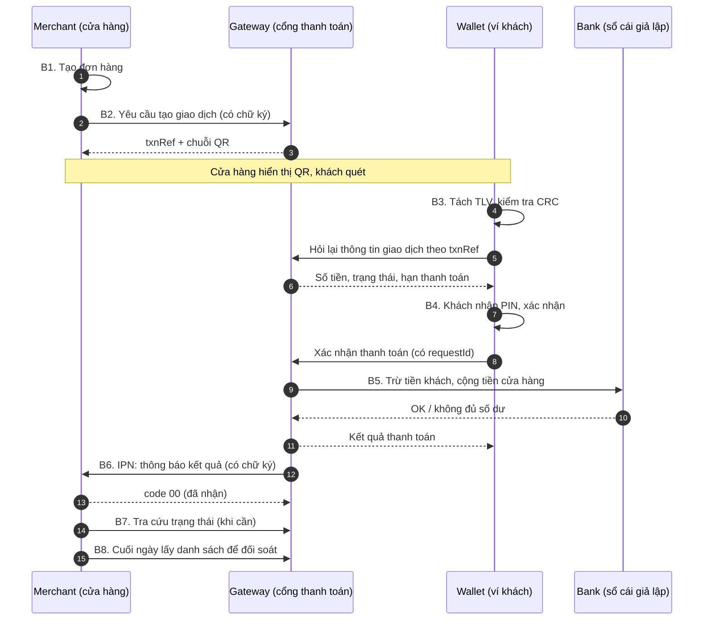

# Bài tập: Luồng thanh toán QR từ đầu đến cuối

Bạn sẽ xây một hệ thống thanh toán QR thu nhỏ, đi qua đủ 8 bước: cửa hàng tạo đơn, cổng thanh toán sinh mã QR, khách quét và trả tiền, cửa hàng nhận thông báo, rồi cuối ngày đối soát. Ví điện tử và ngân hàng đều là giả lập, không dùng tiền thật.

---

## 0. Kiến thức nền cần có

Trước khi vào bài, hãy làm hết các bài tự kiểm tra dưới đây. Làm được hết thì bắt đầu bài chính. Phần này mất khoảng 1–2 tuần.

### 0.1. Java core

| Cần biết | Dùng ở | Tự kiểm tra |
|---|---|---|
| OOP, interface, `record`, `enum`, xử lý exception | Mọi bước | Viết `enum TxnStatus` có hàm `canTransitionTo(next)` |
| Collections: `List`, `Map`, `Set`, stream cơ bản | B8 đối soát | So 2 danh sách giao dịch, tìm phần lệch bằng `Map` |
| Tiền lưu bằng `long` hoặc `BigDecimal`, vì sao không dùng `double` | B1, B5 | Giải thích vì sao `0.1 + 0.2 != 0.3` |
| `java.time`: `Instant`, `ZonedDateTime`, `Clock`, format `yymmddHHmm` | B2, B7 | Sinh chuỗi hạn thanh toán; viết hàm kiểm tra hết hạn dùng `Clock` |
| `String`, `char`, byte, UTF-8, hex | B2, B3 | Đổi `"ABC"` sang byte UTF-8 rồi sang hex |
| Thao tác bit: `^`, `<<`, `&` | CRC ở B2 | Tự cài CRC-16/CCITT-FALSE, chạy với `"123456789"` phải ra `29B1` |
| Đa luồng cơ bản: `ExecutorService`, `CountDownLatch` | Kịch bản 7, IPN chạy nền | Cho 2 luồng cùng tăng 1 biến đếm, quan sát lỗi race condition |

### 0.2. HTTP và REST

- Các method GET/POST, status code (200, 201, 400, 401, 404, 409, 422, 500), header, JSON.
- **Idempotency** là gì: tại sao GET an toàn khi gọi lại, còn POST thì không.
- Webhook (callback): bên kia chủ động gọi vào API của mình.
- Công cụ: Postman hoặc file `.http`, `curl`.
- *Tự kiểm tra:* tự giải thích vì sao sai chữ ký trả 401, còn sai số tiền thì trả 422.

### 0.3. Spring Boot

- Chia tầng Controller, Service, Repository; DTO; kiểm tra đầu vào bằng `@Valid`.
- Xử lý lỗi tập trung bằng `@RestControllerAdvice`.
- Spring Data JPA: entity, repository, query.
- `@Transactional`: transaction commit lúc nào, rollback khi nào.
- Gọi HTTP sang service khác bằng `RestClient` (B3, B4, B6).
- Chạy việc theo lịch hoặc chạy nền bằng `@Scheduled` và `@Async` (job hết hạn, gửi lại IPN).
- *Tự kiểm tra:* viết một API CRUD đơn giản (ví dụ quản lý sản phẩm) dùng H2, có validation và có trả lỗi đúng format.

### 0.4. Cơ sở dữ liệu và transaction (quan trọng nhất cho B5)

- Khóa chính, ràng buộc `UNIQUE` (chống trùng `orderId`, `requestId`), index.
- **ACID**, mức cô lập (isolation level).
- **Khóa bi quan** (`SELECT ... FOR UPDATE`, `@Lock(PESSIMISTIC_WRITE)`) và **khóa lạc quan** (`@Version`).
- *Tự kiểm tra:* viết hàm chuyển tiền giữa 2 tài khoản. Cho 10 luồng cùng chuyển. Tổng tiền của cả hệ thống phải không đổi.

### 0.5. Bảo mật cơ bản

- Phân biệt **hash**, **mã hóa** và **HMAC**.
- Lưu PIN bằng BCrypt, không lưu dạng thô.
- Ký và kiểm tra chữ ký HMAC-SHA256 bằng `javax.crypto.Mac`. So sánh chữ ký bằng `MessageDigest.isEqual` (so sánh thời gian hằng).
- Không ghi log PIN, secret hay chữ ký.
- **CRC không phải là chữ ký:** ai sửa QR cũng tự tính lại CRC được.
- *Tự kiểm tra:* ký chuỗi `amount=55000&orderId=ORD1` với key `secret`, rồi đổi 1 ký tự và chứng minh chữ ký không còn khớp.

### 0.6. Định dạng QR EMV

- Cấu trúc TLV: ID 2 ký tự, độ dài 2 ký tự, rồi đến giá trị. Template lồng nhau (26, 62).
- Ý nghĩa các tag chính: 00, 01, 26, 52, 53, 54, 58, 59, 60, 62, 63.
- QR tĩnh (`01=11`) khác QR động (`01=12`) ở điểm nào.
- *Tự kiểm tra:* đọc code `TlvParser` và `Crc16Calculator` trong project `qr-parser`. Tự tách tay chuỗi QR mẫu trong README thành từng tag.

### 0.7. Nghiệp vụ thanh toán

- Các bên tham gia: khách, ví hoặc ngân hàng phát hành, cổng thanh toán, merchant, ngân hàng của merchant.
- Vòng đời một giao dịch, máy trạng thái (state machine).
- **Bút toán kép (double-entry):** mỗi lần chuyển tiền có một dòng ghi nợ và một dòng ghi có.
- IPN và cơ chế gửi lại; tra cứu trạng thái khi không nhận được IPN.
- Đối soát là gì, và vì sao có thể lệch dù code đúng (ví dụ IPN bị mất).
- *Tự kiểm tra:* vẽ tay luồng thanh toán khi quét VietQR bằng app ngân hàng, rồi giải thích lại cho người hướng dẫn.

### 0.8. Kiểm thử

- JUnit 5, AssertJ, Mockito.
- Test tích hợp bằng `@SpringBootTest` và `MockMvc`.
- Chuẩn bị và dọn dữ liệu test giữa các test.
- Tiêm `Clock` để test hết hạn; dùng `CountDownLatch` để test các yêu cầu gửi đồng thời.

### 0.9. Công cụ

- Git: commit nhỏ, viết commit message rõ ràng, tạo branch.
- Maven: build và test bằng `mvnw`.
- H2 console, đọc log.
- Mermaid để vẽ sơ đồ.

### Thứ tự học gợi ý

1. Java core, HTTP và REST, Git và Maven: phần bắt buộc, nhiều bạn có sẵn.
2. Spring Boot với bài CRUD tự kiểm tra.
3. Cơ sở dữ liệu và transaction với bài chuyển tiền đồng thời. Đây là phần sinh viên hay hổng nhất, nên dành nhiều thời gian nhất.
4. Bảo mật, sau đó là QR EMV (đọc project `qr-parser`).
5. Nghiệp vụ thanh toán, cuối cùng là kiểm thử.

---

## 1. Mục tiêu và phạm vi

**Làm xong bài, bạn phải tự trả lời được:**

- Ai tham gia một giao dịch thanh toán, và mỗi bên giữ dữ liệu gì.
- Mã QR thanh toán chứa gì, và vì sao không được tin vào số tiền in trong QR.
- Tại sao bấm "Thanh toán" 2 lần không được trừ tiền 2 lần.
- Vì sao cửa hàng phải kiểm tra chữ ký khi nhận thông báo kết quả.
- Đối soát là gì, và phát hiện lệch như thế nào.

**Công nghệ khuyến nghị:** Java 21, Spring Boot, cơ sở dữ liệu H2 hoặc PostgreSQL, JUnit. Có thể dùng ngôn ngữ khác nếu người hướng dẫn đồng ý.

**Cách tổ chức code:** chỉ cần một ứng dụng, chia thành 3 package tách biệt. Các package chỉ gọi nhau qua HTTP, không gọi thẳng class của nhau:

- `merchant`: cửa hàng
- `gateway`: cổng thanh toán, kèm ngân hàng giả lập
- `wallet`: ví của khách

**Không cần làm:** giao diện web hoặc app, đọc ảnh QR, kết nối ngân hàng thật, đăng nhập OAuth.

**Được dùng lại:** project `qr-parser` có sẵn để tách TLV và kiểm tra CRC ở bước 3.

---

## 2. Toàn cảnh luồng



> Sơ đồ viết bằng Mermaid, xem được trên GitHub, GitLab hoặc trang https://mermaid.live.

**Nguyên tắc xuyên suốt:**

1. **Gateway là nguồn sự thật duy nhất.** Số tiền và trạng thái luôn lấy từ cơ sở dữ liệu của Gateway, không lấy từ QR.
2. **Mọi thao tác ghi đều idempotent.** Gửi lại cùng một yêu cầu thì trả lại cùng một kết quả, không tạo thêm giao dịch.
3. **Mọi tin nhắn giữa Merchant và Gateway đều có chữ ký HMAC-SHA256.**

---

## 3. Thành phần và dữ liệu

### Bảng dữ liệu tối thiểu

| Bảng | Thuộc service | Các cột chính |
|---|---|---|
| `merchant` | Gateway | `merchant_id`, `name`, `city`, `mcc`, `secret_key`, `ipn_url`, `account_no` |
| `orders` | Merchant | `order_id`, `merchant_id`, `amount`, `description`, `status`, `txn_ref`, `created_at`, `paid_at` |
| `payment_txn` | Gateway | `txn_ref`, `merchant_id`, `order_id`, `amount`, `status`, `qr_string`, `expire_at`, `payer_account`, `bank_ref`, `fail_reason`, `created_at`, `paid_at` |
| `account` | Bank | `account_no`, `owner_name`, `balance`, `version` (dùng cho khóa lạc quan) |
| `ledger_entry` | Bank | `id`, `bank_ref`, `account_no`, `direction` (DEBIT / CREDIT), `amount`, `created_at` |
| `wallet_user` | Wallet | `user_id`, `full_name`, `account_no`, `pin_hash` |
| `ipn_log` | Gateway | `id`, `txn_ref`, `attempt`, `request_body`, `response_code`, `sent_at` |
| `idempotency` | Gateway | `request_id`, `txn_ref`, `response_body`, `created_at` |

Tiền lưu bằng kiểu số nguyên `long`, đơn vị VND. **Không dùng `double`.**

### Dữ liệu mẫu nạp sẵn khi khởi động

| Loại | Giá trị |
|---|---|
| Merchant | `merchant_id=MC001`, `name=SHOP ABC`, `city=HANOI`, `mcc=5499`, `secret_key=secret-mc001`, `ipn_url=http://localhost:8080/api/merchant/ipn`, `account_no=9000001` |
| Tài khoản cửa hàng | `9000001`, số dư 0 |
| Khách 1 | `user_id=U001`, `account_no=1000001`, số dư 1.000.000, PIN `123456` |
| Khách 2 | `user_id=U002`, `account_no=1000002`, số dư 10.000 (dùng để test thiếu tiền) |

---

## 4. Bước 1–2: Tạo đơn hàng và sinh QR

### Bước 1. Merchant tạo đơn hàng

`POST /api/merchant/orders`

**Đầu vào**

```json
{ "amount": 55000, "description": "Thanh toan don hang ao thun" }
```

**Đầu ra: `201 Created`**

```json
{
  "orderId": "ORD20261102001",
  "merchantId": "MC001",
  "amount": 55000,
  "description": "Thanh toan don hang ao thun",
  "status": "CREATED",
  "createdAt": "2026-11-02T09:00:00+07:00"
}
```

**Quy tắc**

- `amount` là số nguyên, từ 1.000 đến 500.000.000.
- `description` có từ 1 đến 19 ký tự. Chỉ dùng chữ không dấu, số và khoảng trắng, vì chuỗi này sẽ vào tag `62/08`.
- Sai quy tắc thì trả `400` kèm mã lỗi `INVALID_AMOUNT` hoặc `INVALID_DESCRIPTION`.

### Bước 2. Gateway tạo giao dịch và sinh QR động

Merchant gọi Gateway: `POST /api/gateway/payments`

**Đầu vào**

```json
{
  "merchantId": "MC001",
  "orderId": "ORD20261102001",
  "amount": 55000,
  "description": "Thanh toan ao thun",
  "expireMinutes": 15,
  "signature": "<hex HMAC-SHA256>"
}
```

**Cách tính chữ ký** (dùng chung cho mọi tin nhắn ký ở các bước sau):

- Bỏ trường `signature` ra.
- Sắp các trường còn lại theo tên tăng dần, nối thành dạng `key=value`, ngăn cách bằng `&`.
- Tính HMAC-SHA256 bằng `secret_key` của merchant, xuất dạng hex chữ thường.
- Ví dụ chuỗi cần ký: `amount=55000&description=Thanh toan ao thun&expireMinutes=15&merchantId=MC001&orderId=ORD20261102001`

**Đầu ra: `201 Created`**

```json
{
  "txnRef": "TX00000001",
  "orderId": "ORD20261102001",
  "amount": 55000,
  "status": "PENDING",
  "expireAt": "2026-11-02T09:15:00+07:00",
  "qrString": "000201010212...6304ABCD"
}
```

Sau bước này, Merchant lưu `txnRef` vào đơn và chuyển đơn sang `WAITING_PAYMENT`.

**Chuỗi QR phải sinh** (theo chuẩn EMV, giống Type 04 của `qr-parser`):

| Tag | Ý nghĩa | Giá trị ví dụ |
|---|---|---|
| `00` | Phiên bản payload | `01` |
| `01` | Phương thức khởi tạo | `12` (QR động) |
| `26` | Thông tin tài khoản merchant (template) | gồm `00` = `A000000775` và `01` = `MC001` |
| `52` | Mã danh mục merchant (MCC) | `5499` |
| `53` | Mã tiền tệ | `704` (VND) |
| `54` | Số tiền | `55000` |
| `58` | Quốc gia | `VN` |
| `59` | Tên merchant | `SHOP ABC` |
| `60` | Thành phố | `HANOI` |
| `62` | Dữ liệu bổ sung (template) | gồm `05` = `01` + `yymmddhhmm` của hạn + `txnRef`, ví dụ `012611020915TX00000001`; `08` = mô tả; `09` = `M` |
| `63` | CRC-16/CCITT-FALSE | 4 ký tự hex, tính trên toàn chuỗi tính cả `6304` |

**Quy tắc**

- Sai chữ ký: `401 INVALID_SIGNATURE`.
- Merchant không tồn tại: `404 MERCHANT_NOT_FOUND`.
- Cùng `orderId` gọi lại khi giao dịch cũ còn `PENDING`: trả lại đúng giao dịch cũ, không tạo mới (idempotent).
- Cùng `orderId` nhưng khác `amount`: `409 ORDER_CONFLICT`.
- `expireMinutes` từ 1 đến 60.
- Viết hàm `buildTlv(tag, value)`. Length đếm theo ký tự và luôn có 2 chữ số.

**Kiểm tra tự làm:** đưa `qrString` vào API `qr-parser` với `type = "04"`. Kết quả phải là `VALID`.

---

## 5. Bước 3–4: Khách quét QR và xác nhận thanh toán

### Bước 3. Ví quét QR

`POST /api/wallet/scan`

**Đầu vào**

```json
{ "userId": "U001", "qrString": "000201010212...6304ABCD" }
```

**Ví xử lý theo thứ tự:**

1. Tách TLV và kiểm tra CRC. Sai thì trả `422 INVALID_QR` hoặc `CRC_MISMATCH`.
2. Đọc `txnRef` từ `62/05` (bỏ 2 ký tự prefix và 10 ký tự hạn thanh toán).
3. Gọi Gateway `GET /api/gateway/payments/{txnRef}` để lấy số tiền và trạng thái thật.
4. So số tiền ở tag `54` với số tiền Gateway trả về. Lệch thì trả `422 AMOUNT_MISMATCH`, vì có thể QR đã bị sửa.
5. Giao dịch không còn `PENDING`, hoặc đã quá `expireAt`: trả `422 TXN_NOT_PAYABLE`.

**Đầu ra: `200 OK`** (thông tin để hiển thị cho khách xác nhận)

```json
{
  "txnRef": "TX00000001",
  "merchantName": "SHOP ABC",
  "merchantCity": "HANOI",
  "amount": 55000,
  "currency": "VND",
  "description": "Thanh toan ao thun",
  "expireAt": "2026-11-02T09:15:00+07:00"
}
```

### Bước 4. Khách xác nhận thanh toán

`POST /api/wallet/payments`

**Đầu vào**

```json
{
  "userId": "U001",
  "txnRef": "TX00000001",
  "amount": 55000,
  "pin": "123456",
  "requestId": "4f1c2a9e-7b3d-4c55-9a10-0e2b6f8d1a77"
}
```

`requestId` là UUID do app ví sinh ra một lần cho mỗi lần bấm nút. Nếu mạng lỗi và app gửi lại, nó giữ nguyên UUID cũ.

**Ví xử lý**

- So PIN với `pin_hash` (dùng BCrypt). Sai PIN thì trả `401 INVALID_PIN`. Sai 3 lần liên tiếp thì khóa 15 phút (`423 PIN_LOCKED`).
- Gọi Gateway: `POST /api/gateway/payments/{txnRef}/confirm` với body `{ "payerAccount": "1000001", "amount": 55000, "requestId": "..." }`.

**Đầu ra: `200 OK`**

```json
{
  "txnRef": "TX00000001",
  "status": "SUCCESS",
  "amount": 55000,
  "bankRef": "BK20261102000001",
  "paidAt": "2026-11-02T09:03:12+07:00",
  "message": "Thanh toán thành công"
}
```

Nếu thất bại, `status` là `FAILED` và có thêm trường `errorCode`, ví dụ `INSUFFICIENT_FUNDS`.

---

## 6. Bước 5: Gateway xử lý giao dịch, trừ và cộng tiền

API nhận: `POST /api/gateway/payments/{txnRef}/confirm`. Đây là bước quan trọng nhất.

**Thứ tự xử lý, tất cả nằm trong một transaction của cơ sở dữ liệu:**

1. Tra bảng `idempotency` theo `requestId`. Đã có thì trả lại đúng `response_body` đã lưu, không làm gì thêm.
2. Khóa dòng `payment_txn` (`SELECT ... FOR UPDATE`).
3. Kiểm tra lần lượt:
   - Giao dịch tồn tại.
   - Trạng thái đang là `PENDING`.
   - Chưa quá `expire_at`. Đã quá thì chuyển sang `EXPIRED` và từ chối.
   - `amount` trong yêu cầu bằng `amount` trong cơ sở dữ liệu.
4. Chuyển trạng thái sang `PROCESSING`.
5. Gọi Bank chuyển tiền: trừ `payer_account`, cộng `account_no` của merchant. Ghi 2 dòng `ledger_entry` (một DEBIT, một CREDIT) chung một `bank_ref`.
6. Bank báo thành công: chuyển `SUCCESS`, lưu `bank_ref` và `paid_at`. Không đủ số dư: chuyển `FAILED`, lưu `fail_reason = INSUFFICIENT_FUNDS`.
7. Lưu phản hồi vào bảng `idempotency`, commit, rồi trả về cho ví.
8. **Sau khi commit**, đẩy việc gửi IPN (bước 6) sang luồng chạy nền. Không gửi IPN bên trong transaction.

**Bất biến phải luôn đúng** (viết test để kiểm):

- Tổng số dư mọi tài khoản trước và sau giao dịch bằng nhau.
- Mỗi `bank_ref` có đúng 2 dòng ledger, tổng DEBIT bằng tổng CREDIT.
- Một `txnRef` chỉ có tối đa một `bank_ref`.

**Đầu ra trả cho ví:**

```json
{ "txnRef": "TX00000001", "status": "SUCCESS", "bankRef": "BK20261102000001", "paidAt": "2026-11-02T09:03:12+07:00" }
```

---

## 7. Bước 6–7: Thông báo kết quả cho merchant (IPN) và tra cứu

### Bước 6. IPN: Gateway báo kết quả cho Merchant

Gateway gọi `POST {ipn_url}`, ví dụ `http://localhost:8080/api/merchant/ipn`.

**Đầu vào** (Gateway gửi đi)

```json
{
  "txnRef": "TX00000001",
  "orderId": "ORD20261102001",
  "amount": 55000,
  "status": "SUCCESS",
  "bankRef": "BK20261102000001",
  "paidAt": "2026-11-02T09:03:12+07:00",
  "signature": "<hex HMAC-SHA256>"
}
```

**Merchant kiểm tra theo thứ tự và trả mã:**

| Điều kiện | Phản hồi Merchant trả về |
|---|---|
| Sai chữ ký | `{ "code": "97", "message": "Invalid signature" }` |
| Không tìm thấy đơn | `{ "code": "01", "message": "Order not found" }` |
| Số tiền không khớp với đơn | `{ "code": "04", "message": "Invalid amount" }` |
| Đơn đã được cập nhật trước đó | `{ "code": "02", "message": "Order already confirmed" }` |
| Hợp lệ: cập nhật đơn sang `PAID` (hoặc `PAYMENT_FAILED`) | `{ "code": "00", "message": "Confirm success" }` |

**Gateway thử gửi lại:**

- Gửi lại khi Merchant không phản hồi, lỗi HTTP 5xx, hoặc phản hồi khác `00` và `02`.
- Tối đa 3 lần, cách nhau 10 giây, 30 giây và 60 giây. Khi làm bài được rút ngắn các khoảng chờ này.
- Mỗi lần gửi ghi một dòng vào `ipn_log`.

### Bước 7. Tra cứu trạng thái

Dùng khi không nhận được IPN, hoặc khách hỏi "tiền đã trừ chưa".

`GET /api/gateway/payments/{txnRef}` (Merchant gửi header `X-Merchant-Id` và `X-Signature`)

**Đầu ra: `200 OK`**

```json
{
  "txnRef": "TX00000001",
  "orderId": "ORD20261102001",
  "amount": 55000,
  "status": "SUCCESS",
  "bankRef": "BK20261102000001",
  "createdAt": "2026-11-02T09:00:00+07:00",
  "paidAt": "2026-11-02T09:03:12+07:00"
}
```

Merchant cũng có `GET /api/merchant/orders/{orderId}`, trả về đơn hàng cùng trạng thái hiện tại.

**Job quét giao dịch hết hạn:** cứ mỗi phút, chuyển các giao dịch `PENDING` đã quá `expire_at` sang `EXPIRED`.

---

## 8. Bước 8: Đối soát cuối ngày

### Gateway cung cấp danh sách giao dịch

`GET /api/gateway/reconciliation?merchantId=MC001&date=2026-11-02`

**Đầu ra: `200 OK`**

```json
{
  "merchantId": "MC001",
  "date": "2026-11-02",
  "successCount": 2,
  "successAmount": 110000,
  "transactions": [
    { "txnRef": "TX00000001", "orderId": "ORD20261102001", "amount": 55000, "status": "SUCCESS", "bankRef": "BK20261102000001", "paidAt": "2026-11-02T09:03:12+07:00" },
    { "txnRef": "TX00000003", "orderId": "ORD20261102003", "amount": 55000, "status": "SUCCESS", "bankRef": "BK20261102000002", "paidAt": "2026-11-02T10:20:00+07:00" }
  ]
}
```

### Merchant tự đối chiếu

`POST /api/merchant/reconcile`

**Đầu vào**

```json
{ "date": "2026-11-02" }
```

**Đầu ra: `200 OK`**

```json
{
  "date": "2026-11-02",
  "matched": 1,
  "missingInMerchant": [ { "txnRef": "TX00000003", "orderId": "ORD20261102003", "amount": 55000 } ],
  "missingInGateway": [],
  "amountMismatch": [],
  "gatewayTotal": 110000,
  "merchantTotal": 55000
}
```

**Ý nghĩa từng loại lệch**

| Loại lệch | Ý nghĩa | Ví dụ nguyên nhân |
|---|---|---|
| `missingInMerchant` | Gateway báo `SUCCESS` nhưng đơn bên Merchant chưa `PAID` | IPN gửi thất bại cả 3 lần |
| `missingInGateway` | Merchant ghi `PAID` nhưng Gateway không có giao dịch thành công | Lỗi logic phía Merchant |
| `amountMismatch` | Cùng `txnRef` nhưng hai bên ghi số tiền khác nhau | |

Merchant được phép tự sửa các đơn thuộc `missingInMerchant` sau khi đã gọi tra cứu ở bước 7 để xác nhận.

---

## 9. Trạng thái giao dịch và bảng mã lỗi

### Trạng thái `payment_txn` (Gateway)

| Từ | Sang | Khi nào |
|---|---|---|
| (mới) | `PENDING` | Bước 2 tạo giao dịch |
| `PENDING` | `PROCESSING` | Bước 5 bắt đầu chuyển tiền |
| `PROCESSING` | `SUCCESS` | Bank trừ và cộng tiền thành công |
| `PROCESSING` | `FAILED` | Không đủ số dư hoặc Bank lỗi |
| `PENDING` | `EXPIRED` | Quá `expire_at` (job quét hoặc lúc xác nhận) |
| `SUCCESS` | `REFUNDED` | Hoàn tiền (phần mở rộng, không bắt buộc) |

Mọi chuyển trạng thái khác phải bị từ chối. Ví dụ không được đi từ `SUCCESS` về `PENDING`, hay từ `EXPIRED` sang `SUCCESS`.

### Trạng thái `orders` (Merchant)

`CREATED` → `WAITING_PAYMENT` → `PAID` hoặc `PAYMENT_FAILED` hoặc `EXPIRED`

### Bảng mã lỗi

| HTTP | Mã lỗi | Bước | Khi nào |
|---|---|---|---|
| 400 | `INVALID_AMOUNT` | 1, 2 | Số tiền ngoài khoảng cho phép |
| 400 | `INVALID_DESCRIPTION` | 1, 2 | Mô tả rỗng, quá 19 ký tự hoặc có ký tự lạ |
| 401 | `INVALID_SIGNATURE` | 2, 7 | Chữ ký HMAC sai |
| 404 | `MERCHANT_NOT_FOUND` | 2 | Không có merchant |
| 409 | `ORDER_CONFLICT` | 2 | Cùng `orderId`, khác số tiền |
| 422 | `INVALID_QR` | 3 | Sai cấu trúc TLV hoặc thiếu tag |
| 422 | `CRC_MISMATCH` | 3 | CRC không khớp |
| 422 | `AMOUNT_MISMATCH` | 3, 5 | Số tiền ở QR hoặc trong yêu cầu khác số tiền trong DB |
| 404 | `TXN_NOT_FOUND` | 3, 5, 7 | Không có `txnRef` |
| 422 | `TXN_NOT_PAYABLE` | 3, 5 | Không còn `PENDING` |
| 422 | `TXN_EXPIRED` | 3, 5 | Quá hạn thanh toán |
| 401 | `INVALID_PIN` | 4 | Sai PIN |
| 423 | `PIN_LOCKED` | 4 | Sai PIN 3 lần |
| 200, `status=FAILED` | `INSUFFICIENT_FUNDS` | 5 | Không đủ số dư |

Mọi lỗi trả về chung một dạng:

```json
{ "errorCode": "TXN_EXPIRED", "message": "Giao dịch đã hết hạn thanh toán", "timestamp": "2026-11-02T09:20:00+07:00" }
```

---

## 10. Kịch bản kiểm thử bắt buộc

Mỗi kịch bản là một test tích hợp JUnit (MockMvc hoặc gọi HTTP thật), chạy được bằng `mvnw test`.

| # | Kịch bản | Kết quả mong đợi |
|---|---|---|
| 1 | Luồng thành công B1 → B8 với khách U001 | Đơn `PAID`; số dư U001 giảm 55.000; MC001 tăng 55.000; đối soát `matched = 1` |
| 2 | QR sinh ra đưa vào `qr-parser` với Type 04 | `VALID` |
| 3 | Sửa 1 ký tự trong tên merchant, giữ CRC | `CRC_MISMATCH` |
| 4 | Sửa tag 54 thành 5000 rồi tính lại CRC | Bước 3 trả `AMOUNT_MISMATCH`, không trừ tiền |
| 5 | Khách U002 (số dư 10.000) trả 55.000 | `FAILED` + `INSUFFICIENT_FUNDS`; số dư không đổi; đơn `PAYMENT_FAILED` |
| 6 | Gửi lại B4 với cùng `requestId` | Kết quả giống lần đầu; tiền chỉ bị trừ 1 lần |
| 7 | Hai yêu cầu xác nhận khác `requestId` gửi cùng lúc (2 luồng) cho cùng `txnRef` | Đúng 1 lần `SUCCESS`; lần kia `TXN_NOT_PAYABLE` |
| 8 | Xác nhận sau khi hết hạn (cho `expireMinutes=1` hoặc giả lập đồng hồ) | `TXN_EXPIRED`; giao dịch `EXPIRED` |
| 9 | Merchant IPN trả lỗi 500 hai lần đầu, lần ba trả `00` | `ipn_log` có 3 dòng; đơn `PAID` |
| 10 | IPN gửi với chữ ký sai | Merchant trả `97`; đơn không đổi |
| 11 | IPN thất bại cả 3 lần, rồi chạy đối soát | `missingInMerchant` chứa giao dịch đó |
| 12 | Sai PIN 3 lần | Lần thứ 3 trả `PIN_LOCKED` |

**Mẹo:** dùng `java.time.Clock` để tiêm thời gian, giúp test hết hạn mà không phải chờ thật.

---

## 11. Sản phẩm nộp, lộ trình và tiêu chí chấm

### Sản phẩm nộp

- Repository Git có commit theo từng bước, không dồn hết vào một commit.
- `README.md` gồm: cách chạy, danh sách API, và sơ đồ luồng do sinh viên tự vẽ lại.
- Collection Postman (hoặc file `.http`) chạy lần lượt từ B1 đến B8.
- Kết quả `mvnw test` chạy pass đủ 12 kịch bản.
- Một trang giải thích ngắn trả lời 5 câu hỏi ở mục 1.

### Lộ trình gợi ý (4 tuần)

| Tuần | Việc cần xong |
|---|---|
| 1 | Dữ liệu mẫu, B1, B2 (sinh TLV, CRC, chữ ký HMAC); kịch bản 2 |
| 2 | B3, B4, B5 (trừ và cộng tiền, idempotency, khóa dòng); kịch bản 1, 3–8, 12 |
| 3 | B6, B7 (IPN, gửi lại, job hết hạn); kịch bản 9–10 |
| 4 | B8 đối soát; kịch bản 11; README và buổi demo |

### Tiêu chí chấm (100 điểm)

| Tiêu chí | Điểm |
|---|---:|
| Luồng thành công B1 → B8 chạy đúng | 25 |
| QR đúng chuẩn TLV và CRC (qua được `qr-parser` Type 04) | 10 |
| Trừ và cộng tiền đúng, idempotent, không trừ trùng khi gửi đồng thời | 20 |
| IPN có chữ ký và gửi lại đúng quy tắc | 15 |
| Đối soát phát hiện đúng các loại lệch | 10 |
| Đủ 12 kịch bản kiểm thử | 10 |
| Code rõ ràng, README, trả lời 5 câu hỏi | 10 |

### Phần mở rộng (cộng điểm)

- Hoàn tiền: `POST /api/gateway/payments/{txnRef}/refund`, gồm cả hoàn một phần.
- Đối soát bằng file CSV thay cho API.
- Tách thành 3 ứng dụng chạy trên 3 cổng khác nhau.
