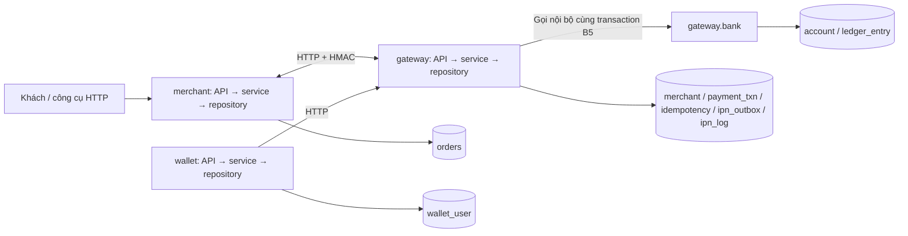
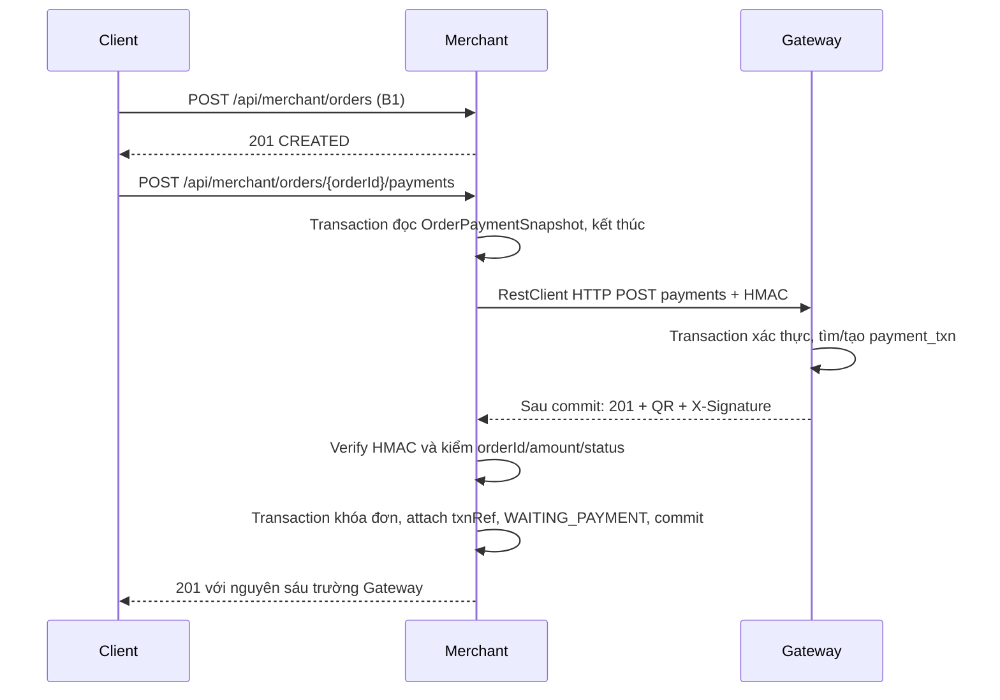
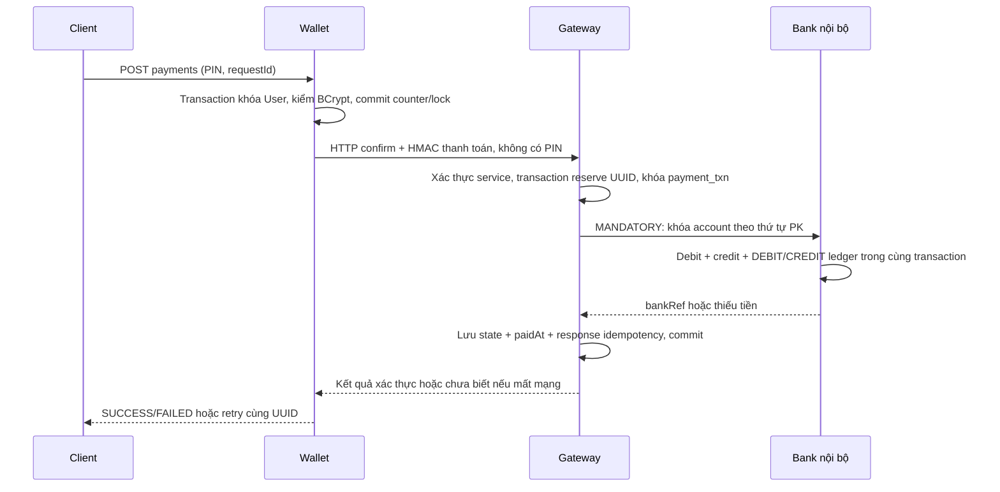
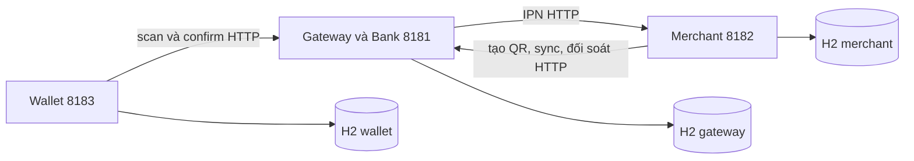

# Phân tích và thiết kế — B1–B8

Tài liệu gốc: [bai-tap-luong-thanh-toan-qr.md](../bai-tap-luong-thanh-toan-qr.md).
Khi có khác biệt, quy tắc nghiệp vụ, API, mã lỗi và kiểm thử trong đề được ưu tiên.
Code hiện tại thực hiện đủ tám bước B1–B8 cùng ba mục cộng điểm: đối soát CSV,
hoàn tiền và Merchant/Gateway/Wallet chạy trên ba cổng với database riêng.
Kết quả thực tế và giới hạn kiểm chứng nằm ở [báo cáo B2](phase2-report.md) và
[báo cáo B3](phase3-report.md), [B4](phase4-report.md), [B5](phase5-report.md)
và [B6](phase6-report.md), [B7](phase7-report.md), [B8](phase8-report.md).

## 1. Quan hệ B1–B8

| Bước | Trách nhiệm và dữ liệu | Phụ thuộc / ranh giới |
|---|---|---|
| B1 | Merchant kiểm tra input, lưu `orders` ở `CREATED`, trả 201 | Chưa tạo giao dịch, QR hay gọi Gateway |
| B2 | Merchant ký yêu cầu; Gateway xác thực, tạo `payment_txn` ở `PENDING`, sinh QR | Merchant → Gateway qua HTTP. Sau phản hồi, Merchant lưu `txnRef`, đổi `WAITING_PAYMENT` trong transaction riêng |
| B3 | Wallet kiểm TLV, CRC, lấy txnRef, hỏi dữ liệu thật, so amount và hạn | Wallet → Gateway qua HTTP; không tin số tiền hay trạng thái từ QR |
| B4 | Wallet kiểm BCrypt PIN, bộ đếm sai và thời gian khóa; chuyển yêu cầu confirm | Wallet → Gateway qua HTTP với requestId UUID giữ nguyên khi retry |
| B5 | Gateway bảo vệ idempotency, khóa giao dịch, kiểm trạng thái/hạn/amount và chuyển tiền | Bank là `gateway.bank`, gọi nội bộ cùng transaction; account, ledger, txn và kết quả idempotency commit cùng nhau |
| B6 | Sau commit Gateway gửi IPN có chữ ký; Merchant xác thực và cập nhật đơn | HTTP, transaction Merchant riêng. Gửi lại có giới hạn; Merchant chống cập nhật lặp |
| B7 | Tra cứu Gateway, xem đơn Merchant; job đánh dấu hết hạn mỗi phút | Tra cứu Merchant → Gateway có HMAC; không suy đoán thành công khi HTTP timeout |
| B8 | Gateway xuất các giao dịch thành công trong ngày; Merchant đối chiếu hai tập | HTTP có HMAC; chỉ sửa missingInMerchant sau khi tra cứu B7 xác nhận |



Chế độ mặc định Java 21 / Spring Boot 3.5.16 / Maven 3.9.16 / H2 có một datasource
và một transaction manager. Chọn Boot 3.5 để dùng Spring MVC, Jackson 2 và JUnit 5 quen
thuộc với bài học. Java 21 nằm trong dải hỗ trợ của
[Spring Boot 3.5](https://docs.spring.io/spring-boot/3.5/system-requirements.html).
[Maven Wrapper](https://maven.apache.org/tools/wrapper/) cố định phiên bản Maven,
có checksum SHA-256 cho archive tải về.

Các package sở hữu controller, DTO, domain, repository và HTTP client của mình.
Không import service, repository, entity hay DTO nội bộ từ hai package còn lại.
`common` chỉ chứa hạ tầng: Clock, HTTP builder, JSON, HMAC, error envelope; không chứa
service nghiệp vụ hoặc repository dùng chung. Bank thuộc Gateway nên được phép gọi
nội bộ; không dựng HTTP Bank vì sẽ phá vỡ tính nguyên tử B5.
Chưa thêm broker, cache, service discovery, OAuth, frontend hoặc thư viện kiến trúc.

## 2. Mô hình dữ liệu

Đã tạo `orders`, `merchant`, `payment_txn`, sequence `merchant_order_seq` và
`gateway_txn_seq`. `data.sql` nạp MC001 nếu thiếu, không ghi đè registry đã có.
Đã bổ sung wallet_user, account, ledger_entry, idempotency, bank_ref_seq và hai bảng
IPN. Seed User/Bank chỉ insert khi thiếu, không reset khi restart.

| Bảng / chủ sở hữu | Khóa, cột chính và quan hệ dự kiến |
|---|---|
| `orders` / Merchant — đã tạo | PK `order_id`; merchant_id; BIGINT amount; VARCHAR(19) description; status; nullable UNIQUE txn_ref; created_at; nullable paid_at; version cho optimistic locking; index B8(merchant_id,status,paid_at) |
| `merchant` / Gateway — đã tạo | PK merchant_id; name, city, mcc, secret_key, ipn_url; account_no là giá trị. B5 kiểm account tồn tại dưới khóa Bank, không FK metadata để bảo toàn registry B2 |
| `payment_txn` / Gateway — đã tạo | PK txn_ref; merchant_id FK → merchant; UNIQUE(merchant_id, order_id); amount, description, status, qr_string, expire_at; nullable payer_account, UNIQUE bank_ref, fail_reason, paid_at; created_at/version. B7 index(status,expire_at), B8 index(merchant_id,status,paid_at) |
| `account` / Bank — đã có | PK account_no; owner_name; balance BIGINT CHECK balance >= 0; version |
| `ledger_entry` / Bank — đã có | PK id; txn_ref FK → payment_txn; bank_ref; account_no FK → account; DEBIT/CREDIT; amount > 0; created_at; UNIQUE(bank_ref,direction), UNIQUE(txn_ref,direction) |
| `wallet_user` / Wallet — đã có | PK user_id; full_name; account_no tham chiếu logic; pin_hash BCrypt; failed_pin_attempts, pin_locked_until, version |
| `ipn_outbox` / Gateway — đã có | PK txn_ref FK → payment_txn; snapshot ipn_url/request_body; state, attempt_count, next_attempt_at, lease_until/token, created_at/version; index tìm việc đến hạn |
| `ipn_log` / Gateway — đã có | PK id; txn_ref FK → ipn_outbox; attempt, request_body đã bỏ signature, response_code, sent_at, finished_at, http_status/error_type; UNIQUE(txn_ref, attempt) |
| `idempotency` / Gateway — đã có | PK request_id kiểu UUID; txn_ref tham chiếu logic để lưu cả TXN_NOT_FOUND; payer_account/amount làm fingerprint cùng txn_ref; http_status/response_body, created_at/version |

Quan hệ qua ranh giới thành phần là tham chiếu bằng giá trị, không phải JPA association
hoặc FK: orders.merchant_id/order_id/txn_ref và wallet_user.account_no. Merchant không
đọc bảng merchant của Gateway để tạo đơn B1; MC001 là cấu hình cục bộ tin cậy.
Trong Gateway được dùng FK vì các bảng cùng chủ sở hữu và chung transaction với Bank.

Tiền luôn là `long`/BIGINT VND. Mốc thời gian lưu `Instant`/TIMESTAMP WITH TIME ZONE;
API xuất ISO-8601 với offset +07:00, ngày nghiệp vụ và QR dùng Asia/Ho_Chi_Minh.
Clock được inject, test không phải chờ thời gian thực.

`db/gateway.sql`, `db/merchant.sql` và `db/wallet.sql` tạo bảng bằng IF NOT EXISTS.
Hibernate `validate`, không dùng create-drop
trên dev. H2 dev dùng file `data/qr-payment` với `WRITE_DELAY=0` để đồng bộ ghi file
khi commit, test dùng memory và dọn dữ liệu từng test. Phép thử dừng tiến trình ngay
sau HTTP 201 phát hiện chế độ ghi trễ mặc định có thể mất đơn vừa commit, nên chọn
đồng bộ cho bài tập ưu tiên dữ liệu. Xem [SET WRITE_DELAY của H2](https://h2database.com/html/commands.html#set_write_delay).
Thay schema ở các giai đoạn sau cần script thay đổi rõ ràng; IF NOT EXISTS không tự
nâng cấp một bảng cũ. Chưa cần thêm Flyway cho một phiên bản schema của bài tập này.

## 3. Transaction, concurrency và HTTP

- **B1 đã triển khai:** service `@Transactional`; cấp ID từ sequence DB, lưu đơn,
  commit trước khi controller gửi 201. PK, CHECK amount/description/status và UNIQUE
  txn_ref bảo vệ thêm ở DB. Không dùng timestamp/mã đếm RAM hoặc count()+1 làm ID.
  `ORD` + ngày yyyyMMdd + sequence toàn cục đệm tối thiểu ba chữ số; không reset mỗi
  ngày, không yêu cầu liên tục, chấp nhận khoảng trống khi rollback/khởi động lại do
  sequence cache. `@Version` chuẩn
  bị cho cập nhật đồng thời. B2 cập nhật đơn qua khóa bi quan trong transaction ngắn.
- **B2 đã triển khai:** kiểm merchant, chữ ký và validation; UNIQUE(merchant_id, order_id)
  là tuyến bảo vệ cuối khi tạo đồng thời. Nếu insert tranh chấp, rollback transaction
  đó rồi đọc giao dịch thắng trong transaction mới, tránh dùng transaction đã lỗi.
  Cùng orderId/PENDING cùng amount trả giao dịch cũ, giữ nguyên QR và hạn; khác amount
  trả đúng 409 ORDER_CONFLICT. Không tự tạo giao dịch thứ hai cho đơn đã terminal.
- **B5 đã triển khai:** READ_COMMITTED + PESSIMISTIC_WRITE payment_txn; khóa hai account
  theo account_no tăng dần, kể cả hai txn khác nhau cùng sử dụng một tài khoản.
  Bank dùng propagation MANDATORY để không vô tình chạy ngoài transaction confirm.
  Không dùng REQUIRES_NEW cho chuyển tiền. Có version account như đề, khóa bi quan
  là cơ chế chính; không retry ghi tiền mù quáng khi gặp optimistic conflict.
- Tra idempotency đầu tiên rồi reserve UUID bằng insert unique cùng transaction,
  trước khi khóa payment_txn. Request trùng chờ PK insert rồi rollback transaction
  thua, đọc winner trong transaction mới và kiểm fingerprint. Khóa UUID trước cũng
  chặn cùng requestId dùng cho hai txn khác nhau. Không nuốt exception constraint
  trong transaction rollback-only. Dùng outcome để trả lỗi hết hạn sau commit,
  tránh throw RuntimeException làm rollback mất thay đổi EXPIRED.
- Thiếu số dư trả outcome FAILED và lưu kết quả idempotency cùng transaction. Lỗi hạ
  tầng bất ngờ khi cập nhật account/ledger phải rollback tất cả; không catch exception
  rồi commit nửa lần chuyển tiền. Nếu cần ghi FAILED do Bank lỗi, chỉ thực hiện sau
  khi chắc chắn toàn bộ chuyển tiền đã rollback, trong transaction xử lý riêng.
- B5 đã test tổng số dư không đổi, đúng cặp ledger DEBIT/CREDIT, tối đa một bank_ref
  cho mỗi txnRef, replay giống kết quả gốc và tranh chấp hai requestId khác nhau.
- HTTP qua `RestClient`: connect timeout 3s, read timeout 5s, không tự follow redirect.
  B1 chưa phát sinh HTTP liên thành phần. B2, B3 và B4 đã dùng RestClient.
  Chỉ retry với khóa nghiệp vụ giữ nguyên;
  timeout không đồng nghĩa thất bại thanh toán. Không giữ transaction/khóa DB khi gọi
  HTTP. Merchant gọi Gateway xong mới cập nhật local, có thể khôi phục qua replay/B7.

## 4. HMAC, QR, PIN, IPN và đối soát

**HMAC B2 đã triển khai:** dùng UTF-8; bỏ signature; sort tên trường tăng dần; nối key=value bằng &,
không URL-encode, không đổi khoảng trắng hay format timestamp trong lúc verify;
HMAC-SHA256 qua `javax.crypto.Mac`, lowercase hex. Verify hex hợp lệ rồi so byte bằng
`MessageDigest.isEqual`. Các trường null tùy chọn được bỏ khỏi cả JSON gửi đi và
canonical string. Không log PIN, secret hoặc signature. Không serialize entity để ký.
Merchant chỉ xác minh với secret cục bộ; Gateway dùng secret của merchant đăng ký.
Dev seed secret là dữ liệu giả lập của đề, không dùng làm secret triển khai thật.

**QR B2 đã triển khai:** buildTlv length tính theo ký tự, hai chữ số, reject value >99; giữ nguyên
tất cả tag, template và giá trị của đề. Tag62/05 = 01 + yyMMddHHmm của expireAt +
txnRef; tag62/08 tối đa 19 ASCII; tag62/09=M. CRC-16/CCITT-FALSE với poly 0x1021,
init 0xFFFF, refin/refout=false, xorout=0; vector 123456789 → 29B1; tính UTF-8 trên
toàn payload bao gồm 6304 rồi append bốn ký tự hex. CRC chỉ phát hiện lỗi, không
xác thực người tạo. B3 parse xong phải hỏi Gateway và so amount thật trước khi trả
thông tin cho khách. Đã tìm thấy project gốc ở `../qr-parser/qr-parser`, sao chép
pom và main source không chỉnh sửa vào `.build/` để build trong vùng được ghi.
`QrParserCompatibilityIT` đã gọi API project gốc với QR sinh từ Gateway, type 04:
HTTP 200, status VALID, CRC VALID. Không dùng parser tự viết để xác nhận tương thích.

**PIN:** Wallet dùng BCrypt, không đưa PIN sang Gateway; khóa user khi cập nhật số lần
sai để hai request không vượt bộ đếm. Lần sai thứ ba trả 423 PIN_LOCKED, khóa 15 phút;
thành công hoặc hết thời gian khóa reset bộ đếm. B4 lưu wallet_user bền vững và B5
có account/ledger. PIN đúng mới được gọi HTTP, không gửi PIN sang Gateway.

**IPN B6:** `IpnEnqueuer` MANDATORY ghi `ipn_outbox` cùng transaction B5 khi SUCCESS
hoặc FAILED. Snapshot URL/body/HMAC không đổi khi retry. Worker NEVER gọi claim
trong transaction ngắn, HTTP RestClient ngoài transaction, rồi lưu ACK/lịch retry
trong transaction khác. PK txn_ref và replay B5 ngăn job trùng. Row lock, lease/token
và log attempt bền vững cho phép nhiều worker và thu hồi sau crash. Chỉ nhận 00/02
trên HTTP 2xx là đã giao; ba attempt tổng cộng, lần đầu ngay khi claim, sau đó +10s,
+30s tính từ hoàn tất lần trước. Merchant xác thực HMAC trước; khóa đơn, kiểm owner,
amount, txnRef và trạng thái trước khi cập nhật. Chi tiết và giới hạn ở mục 11.

**Đối soát:** danh sách SUCCESS theo paid_at trong khoảng [đầu ngày +07, đầu ngày kế
tiếp +07), cộng long; Merchant lấy snapshot local và dữ liệu Gateway qua HTTP ngoài
transaction ghi. Map theo txnRef, phân biệt missingInMerchant/missingInGateway/
amountMismatch; amountMismatch không đồng thời đếm matched hoặc missing. API báo cáo
không ghi dữ liệu. Sửa missingInMerchant bằng thao tác POST sync B7 riêng, có HMAC và khóa.

## 5. Điểm chưa rõ và quyết định

| Điểm trong đề | Quyết định / trạng thái |
|---|---|
| Ví dụ B1 mô tả dài hơn 19 | Quy tắc 1–19 ưu tiên; ví dụ gốc bị trả INVALID_DESCRIPTION. Demo dùng `Thanh toan ao thun` |
| Chữ không dấu, số, khoảng trắng chưa nêu tập ký tự | ASCII A–Z/a–z/0–9 và dấu cách U+0020; không tab/newline/Unicode; chuỗi chỉ dấu cách là rỗng; không trim hoặc sửa input |
| JSON số thực hoặc chuỗi số có thể bị Jackson ép thành Long | Reject cả 55000.0, 1e3, "55000", boolean, overflow; không cắt phần lẻ. description không được ép từ số/boolean |
| Hai trường B1 cùng sai | Validation báo INVALID_AMOUNT trước; nếu lỗi kiểu xảy ra khi parse, báo trường không parse được |
| JSON hỏng/không body/lỗi máy chủ chưa có mã | Bổ sung mã kỹ thuật INVALID_REQUEST (HTTP 400 hoặc status HTTP tương ứng) và INTERNAL_ERROR (500), cùng envelope; không đổi hai mã nghiệp vụ B1, không lộ dữ liệu/stacktrace |
| Định dạng orderId là ví dụ, không có thuật toán bắt buộc | ORD + ngày nghiệp vụ + sequence DB tối thiểu 3 số, PK bảo vệ; không đặt giới hạn 999 đơn/ngày |
| “Mọi thao tác ghi idempotent” nhưng B1 không có khóa client | Giữ đúng API B1, không thêm body/header. Hai POST có amount/description giống nhau là hai đơn. Không thể phân biệt retry với mua hàng mới; không dùng hash body để gộp đơn. Đây là giới hạn hợp đồng gốc; muốn retry B1 an toàn phải thống nhất thêm client request key ở một thay đổi yêu cầu riêng. B2/B5 áp dụng đầy đủ khóa orderId/requestId của đề |
| Cách Merchant kích hoạt B2 chưa có endpoint | Đã chọn POST /api/merchant/orders/{orderId}/payments, body chỉ expireMinutes. B1 giữ nguyên CREATED; amount/description/merchantId lấy từ DB, trường lạ bị từ chối |
| B2 cùng orderId/PENDING nhưng đổi description/hạn | Nếu amount không đổi, ưu tiên quy tắc trả đúng txn cũ; không sửa payload/QR/hạn. Với trạng thái terminal không tạo txn mới, dự kiến trả trạng thái txn hiện có |
| B3 nói quá hạn → TXN_NOT_PAYABLE, bảng lỗi và test #8 dùng TXN_EXPIRED | B3 dùng TXN_EXPIRED khi EXPIRED hoặc PENDING đến/quá expireAt; terminal khác dùng TXN_NOT_PAYABLE. B5 hiện commit EXPIRED khi confirm hết hạn, đã có test #8 tương ứng |
| Cùng requestId nhưng khác txn/account/amount | B5 trả 409 IDEMPOTENCY_CONFLICT; không chuyển tiền lại và không trả dữ liệu outcome của payload khác |
| Chữ ký response, query GET chưa minh họa | Mọi tin Merchant–Gateway có HMAC: GET ký merchantId + txnRef, reconciliation ký date + merchantId, đặt ở X-Signature; response ký toàn bộ JSON để giữ nguyên body đề. Array/object B8 dùng JSON compact UTF-8, sort key đệ quy, giữ array order; Gateway sort transactions theo txnRef. Đã có vector B8 đối chiếu Python độc lập |
| Wallet gọi GET Gateway trong B3 nhưng B7 nêu header Merchant | GET hiện phân biệt bằng credential đã xác thực: Wallet dùng Bearer token riêng, chỉ projection xác nhận; Merchant bắt buộc HMAC và quyền sở hữu. Header Merchant thiếu/sai/mixed không fallback Wallet. Không dùng query caller hoặc header vai trò tự khai để bỏ qua HMAC |
| “3 lần” IPN nhưng liệt kê 3 khoảng chờ | Yêu cầu B6 mới làm rõ: tổng 3 attempt, lần đầu ngay khi worker claim sau commit, lần hai +10s, lần ba +30s từ kết thúc lần trước; mốc 0/10/40 nếu HTTP tức thời. Không lần thứ tư; thay quyết định dự kiến trước B6 |
| Dữ liệu mẫu U002 thiếu PIN và full_name | Seed ở B4/B5; chọn tên mô tả và PIN giả lập 123456 cho U002, BCrypt khi lưu, ghi rõ seed. Chưa seed các thành phần ngoài B1 |
| Chưa chỉ rõ ngày đối soát theo createdAt hay paidAt | Dùng ngày paidAt vì đối soát giao dịch thành công; múi giờ +07:00, interval nửa mở |

## 6. B2 đã triển khai: các ranh giới transaction



- `MerchantPaymentService` và `GatewayPaymentService` dùng propagation NEVER, tránh
  caller vô tình bao toàn bộ điều phối/HTTP trong transaction. Transaction nằm trong
  bean riêng: `MerchantPaymentStore` và `PaymentCreationTransaction`.
- Merchant chỉ nhận expireMinutes từ client, từ chối trường lạ. Snapshot lấy
  orderId/merchantId/amount/description từ DB; không đọc registry Gateway hoặc import
  DTO/entity/repository của Gateway. DTO HTTP ở Merchant và Gateway là riêng biệt.
- Unique `(merchant_id, order_id)` chặn cả hai request chưa thấy row lúc đọc. Insert
  thua rollback; service ngoài transaction đọc winner qua transaction mới, so amount
  để replay hoặc trả 409 ORDER_CONFLICT. Không dùng synchronized hoặc cache RAM.
- Merchant attach dùng SELECT FOR UPDATE và chỉ CREATED → WAITING_PAYMENT;
  WAITING_PAYMENT cùng txnRef là no-op; ref khác/trạng thái khác trả ORDER_CONFLICT.
- Không ghi trạng thái trung gian kiểu “đang gọi HTTP” vào orders. Mất response, lỗi
  verify hoặc attach rollback để đơn còn CREATED; retry cùng orderId lấy đúng txn cũ.
  Không có tự động retry nền hoặc cơ chế tạo lại B1. Cơ chế này cũng xử lý crash giữa
  hai commit, miễn client tiếp tục cùng orderId và giao dịch còn PENDING.
- Gateway trả 201 cho cả tạo và replay; giữ nguyên txnRef/QR/hạn/description cũ nếu
  amount không đổi, kể cả khi job B7 đã chuyển EXPIRED. Merchant B2 vẫn chỉ nhận
  PENDING như hợp đồng cũ; dùng B7 để tra cứu/sync trạng thái terminal, không tạo txn mới.

## 7. Chi tiết hợp đồng B2 và giả định bổ sung

- `txnRef = TX` + sequence 8 chữ số. Sequence MAXVALUE 99999999, NO CYCLE, không reset
  khi restart. Tag62/05 có 22 ký tự, nằm trong giới hạn 25 của Type04 gốc. Chấp nhận
  sequence gap khi rollback/restart; hết miền sequence thì thất bại, không quay vòng.
- expireAt lấy Clock + expireMinutes, độ chính xác giây; QR biểu diễn hạn đến phút
  `yyMMddHHmm` đúng đề, không dùng mốc QR để cập nhật dữ liệu Gateway. Merchant giữ
  nguyên offset +07 khi deserialize/serialize, không tự đổi expireAt thành UTC.
- merchantId chỉ ASCII chữ/số tối đa 13 (giới hạn tag26/01); orderId ASCII chữ/số,
  `_`/`-`, tối đa 32. Reject ký tự phân cách `&`/`=` trong identifier để tránh nhập
  nhằng canonicalization. Body Gateway có trường lạ bị reject thay vì bỏ khỏi HMAC.
- Request JSON đúng kiểu được validate trước merchant lookup/HMAC; amount ưu tiên
  trước description rồi expireMinutes. Merchant lookup trước kiểm signature như
  quy tắc 404 của đề. Signature thiếu/sai/không lowercase hex 64 ký tự → 401.
- Bổ sung INVALID_EXPIRE_MINUTES (400) vì đề chưa đặt mã cho hạn không hợp lệ;
  ORDER_NOT_FOUND (404) cho endpoint Merchant mới; GATEWAY_UNAVAILABLE và
  INVALID_GATEWAY_RESPONSE (502) cho kết quả HTTP không xác định/không đáng tin.
  Giữ nguyên mã nghiệp vụ B1/B2 đã quy định và envelope errorCode/message/timestamp.
- Gateway ký response JSON bằng secret của merchant trong header X-Signature,
  không thêm field vào sáu trường đề bài. Ký cả error envelope nếu đã parse được
  merchantId đăng ký; unknown merchant hoặc JSON chưa parse được không có key để
  chọn, nên response này không có chữ ký. Merchant không phản chiếu nội dung lỗi
  chưa xác thực và không dùng chúng để thay đổi đơn. Error xác thực được chỉ chuyển
  tiếp mã whitelist với HTTP tương ứng, không phản chiếu message Gateway tùy ý.
- HMAC giữ nguyên giá trị scalar B2, null optional bỏ qua ở root. B8 dùng JSON compact
  cho array/object, sort key đệ quy và giữ thứ tự array. DTO request và config có secret
  được redact toString; giảm log Spring web/HTTP/SQL-init để không log signature hay
  literal secret trong seed. Không tạo endpoint hiển thị registry/secret.
- Seed MC001 theo đề, account_no chỉ metadata, không tạo account hay chuyển tiền.
  `schema.sql` B2 chỉ bổ sung bảng/sequence mới; không sửa orders. Smoke test JAR đã
  nâng cấp bản sao file H2 B1 có 2 đơn, giữ dữ liệu cũ, tạo/replay một payment mới.

## 8. Kiểm thử và phạm vi dừng

Đã chạy 118 test: 66 B1 và 52 B2, 0 failure/error/skipped; có kiểm chứng API gốc
qr-parser Type04 qua HTTP, không chỉ so TLV bằng code tự viết. Test bao phủ cả hai
request đồng thời khác amount (một 201, một 409), hai request Merchant cùng đơn,
response sai HMAC/JSON hỏng, mất response sau Gateway commit, attach rollback và retry.
Xem lệnh và evidence trong [phase2-report.md](phase2-report.md).

Mốc B2 ở trên giữ nguyên kết quả 118 test. Kết quả mở rộng B3 ở báo cáo B3.

## 9. B3: quét QR và GET có phân quyền

```mermaid
sequenceDiagram
    participant C as Client
    participant W as Wallet
    participant G as Gateway
    C->>W: POST /api/wallet/scan (userId, qrString)
    W->>W: Parse TLV, required tags, 62/05 và CRC
    W->>G: RestClient GET /payments/{txnRef}, credential Wallet
    G->>G: Xác thực quyền đọc, transaction chỉ đọc payment + merchant
    G-->>W: Projection xác nhận + X-Signature, no-store
    W->>W: Verify HMAC/txnRef; so amount; kiểm status và Clock
    W-->>C: 200: thông tin thật từ Gateway hoặc error envelope
```

- Wallet sở hữu parser và HTTP DTO riêng, không import Gateway. B3 không mở transaction
  khi HTTP, không có bảng mới, không ghi DB và không chuyển PENDING sang EXPIRED.
  CRC chuyển thành thuật toán chung trong common/qr; facade Gateway giữ nguyên API
  B2 để tái sử dụng đúng thuật toán mà không import nghiệp vụ qua ranh giới.
- Parser nhỏ chỉ phục vụ cấu trúc B2: giới hạn 512 ký tự UTF-16, header tag/length là
  hai số ASCII, length tính code point, đọc hết payload/template 26/62, reject tag lặp,
  thiếu tag, value cắt ngắn, control character/unpaired surrogate; 00 đầu, 63 cuối,
  6304 + bốn hex. Không trim dữ liệu. Tag lạ hợp lệ về TLV có thể tồn tại.
- Bắt buộc các tag của B2 và 26/00,26/01,62/05,62/08,62/09; kiểm các giá trị cố định
  của QR động VND/VN/GUID. 62/05 đúng prefix 01 + yyMMddHHmm hợp lệ + TX và 8 số như
  B2 hiện sinh. Thế kỷ 20yy chỉ dùng kiểm ngày hợp lệ, không dùng làm hạn thanh toán.
  Hạn quyết định là expireAt trả về từ Gateway.
- CRC sai sau khi cấu trúc đã hợp lệ → CRC_MISMATCH; cấu trúc/trường sai → INVALID_QR.
  Sau lookup, ưu tiên AMOUNT_MISMATCH trước trạng thái/hạn, đúng thứ tự đề. Trạng thái
  terminal khác EXPIRED → TXN_NOT_PAYABLE; PENDING tại expireAt đã không còn payable.
- GET cùng đường dẫn nhưng hai hợp đồng theo credential: Wallet Bearer credential chỉ
  nhận projection 8 trường, không orderId/bankRef/tài khoản; Merchant cặp header HMAC
  nhận các trường B7, chỉ khi merchantId sở hữu giao dịch. Không có nhánh anonymous.
  Chữ ký GET Merchant là canonical merchantId + txnRef; không phụ thuộc caller tự khai.
- Nếu có bất kỳ header Merchant: bắt buộc đúng một header mỗi loại và không trộn
  Authorization. Sai/missing/duplicate/mixed → 401 INVALID_SIGNATURE, không thử lại
  nhánh Wallet. Merchant hợp lệ nhưng khác chủ sở hữu → 404 TXN_NOT_FOUND.
- Sau xác thực, ký cả thành công và lỗi lookup bằng secret tương ứng, no-store.
  Wallet verify bằng credential riêng của mình, không giữ secret Merchant. Kết nối
  mất/5xx → 502 GATEWAY_UNAVAILABLE; response hỏng/sai HMAC/txnRef → 502
  INVALID_GATEWAY_RESPONSE; chỉ 404 TXN_NOT_FOUND có xác thực được chuyển nguyên mã.
- Credential mẫu dev được cấu hình qua QR_WALLET_READ_TOKEN hai phía; không đưa vào
  QR/body scan, không log. Đây là credential service nội bộ, không phải xác thực U001.
  userId được validate hình thức, chưa có user registry/PIN hay wallet_user ở B3.

Kết quả B3: 185 test PASS (118 cũ + 67 mới), không failure/error/skipped. Chưa có
full flow B1–B8; các ca CRC sửa tên và sửa amount rồi tính lại CRC ở B3 đã được test.

Mốc B3 giữ nguyên API. B7 hiện tái sử dụng GET này, không thay đổi quyền đọc Wallet.

## 10. B4–B5: transaction, idempotency và khóa tiền



- B4 lỗi PIN trả outcome khỏi transaction rồi mới throw lỗi API, nên bộ đếm không
  bị rollback. Khóa User bằng DB, mọi lần xác thực sai đều đếm, kể cả cùng UUID.
  PIN đúng reset counter; khóa 15 phút dùng Clock. BCrypt strength 10, không raw PIN.
- HMAC confirm dùng secret riêng QR_WALLET_PAYMENT_SECRET và canonical body cộng
  txnRef. Không cho dùng credential đọc, header Merchant hay nhiều signature. Body
  được ký ràng buộc account nguồn/amount/UUID/path; account chỉ từ User đã xác minh.
- ConfirmationTransaction dùng READ_COMMITTED; GatewayConfirmationService dùng
  NEVER. Bank MANDATORY tham gia cùng datasource/transaction manager; không HTTP
  hoặc gọi service Merchant trong transaction Bank.
- Reserve row UUID chưa có response trong transaction chưa commit. Mọi outcome
  nghiệp vụ đi qua finish lưu cả HTTP status/body; lỗi hệ thống rollback cả
  reservation/payment/account/ledger. Cache không FK txn_ref để lưu TXN_NOT_FOUND.
- Cùng UUID/payload trả nguyên status/body; không bankRef/event thêm. UUID khác
  payload → 409 IDEMPOTENCY_CONFLICT; khác UUID/cùng txn bị payment lock chặn chuyển
  lần hai. Fingerprint là bộ giá trị txnRef/payerAccount/amount, không hash gần đúng.
- Account khóa theo PK tăng dần, có version bổ trợ, không synchronized. Kiểm số dư
  trước debit; Math.addExact chặn credit overflow. Flush không commit: lỗi xảy ra
  sau debit/credit/ledger/cache vẫn rollback được mọi bảng.
- Thiếu tiền: FAILED + 200 INSUFFICIENT_FUNDS, không ledger. Thiếu account: FAILED +
  404 ACCOUNT_NOT_FOUND, không ledger. Source=destination: 422 INVALID_TRANSFER trước
  PROCESSING. Lỗi hệ thống: rollback về PENDING; retry cùng UUID an toàn.
- Hết hạn commit EXPIRED và outcome 422. Amount mismatch giữ PENDING, cache lỗi 422.
  Clock kiểm sau payment lock; không cache lỗi hệ thống chưa hoàn tất.
- PaymentCompleted được publish trong transaction để quan sát. B6 ghi outbox trực
  tiếp cùng transaction, không dựa vào listener/event trong RAM để bảo đảm giao nhận.

219 test PASS: 185 B1–B3, 12 B4, 22 B5. Test B5 gồm 21 money/concurrency và một IT
restart hai process production thật/H2 file. Xem [báo cáo B5](phase5-report.md).
Mốc B5 được giữ để đối chiếu. B6 hiện cập nhật Merchant qua IPN sau commit B5.

## 11. B6: outbox, HTTP và Merchant transaction

```mermaid
sequenceDiagram
    participant G as B5 Gateway/Bank
    participant D as Gateway DB
    participant W as IPN Worker
    participant M as Merchant HTTP
    G->>D: Transaction: tiền + ledger + payment + idempotency + outbox READY
    G->>D: COMMIT
    W->>D: Transaction: khóa outbox, LEASED + token, log IN_PROGRESS
    D-->>W: COMMIT + snapshot request
    W->>M: POST ipn_url + HMAC (không transaction Gateway)
    M->>M: HMAC; transaction khóa đơn, kiểm dữ liệu, cập nhật; COMMIT
    M-->>W: 00/02 hoặc lỗi
    W->>D: Transaction: kiểm token, log kết quả + DELIVERED/READY/EXHAUSTED
```

- `gateway.ipn` sở hữu toàn bộ job/log/HTTP client. `merchant` có DTO/service IPN
  riêng, không import Gateway. Chỉ thay B5 bằng hai lời gọi enqueue trong nhánh kết
  quả terminal; không đổi BankTransferService, hợp đồng API hay khóa/idempotency B5.
- `READY → LEASED → DELIVERED`; lỗi còn budget trở lại READY với next_attempt_at;
  lỗi attempt thứ ba thành EXHAUSTED. Không có thao tác xóa job hoặc gửi lại tiền.
  Unique(txn_ref,attempt), CHECK state/attempt/lease và @Version bổ trợ khóa DB.
- Claim lấy danh sách txnRef scalar rồi SELECT FOR UPDATE và kiểm lại điều kiện;
  không dùng entity đọc trước khóa hoặc mutex RAM để phối hợp worker. Log được ghi
  cùng claim trước HTTP; DB lỗi trước commit claim thì chưa được gửi.
- Lease 60s (cấu hình tối thiểu 15s), connect 3s/read 5s, poll 1s. Lease hết hạn:
  attempt chưa rõ kết quả ghi UNKNOWN_AFTER_CRASH, tính lần tiếp theo +10/+30 kể từ
  lúc thu hồi; nếu đã attempt 3 thì EXHAUSTED. Token ngăn ACK muộn ghi đè job đã
  thu hồi. Attempt bỏ dở vẫn tiêu một slot vì không thể biết Merchant đã nhận chưa.
- Merchant kiểm HMAC với secret MC001 cục bộ trước khi tra đơn. HMAC dùng scalar
  canonicalization B2; bankRef/paidAt của FAILED được bỏ khỏi JSON và chuỗi ký.
  Giá trị null cũng bị bỏ khi ký; paidAt khi nhận là String để không đổi format.
  Sau đó khóa đơn, kiểm merchant sở hữu, amount, txnRef, trạng thái. Sai binding
  txnRef trả 01 vì đề không dành code riêng. Chỉ WAITING_PAYMENT được chuyển sang
  PAID/PAYMENT_FAILED; trạng thái khác trả 02 và giữ nguyên dữ liệu.
- Chữ ký đúng nhưng status không phải SUCCESS/FAILED, SUCCESS thiếu bankRef/paidAt
  hoặc FAILED chứa giá trị hai trường này trả 400 INVALID_REQUEST. JSON sai kiểu/
  trường lạ bị chặn bởi lớp JSON hiện có, trước khi vào service.
- Giao nhận có thể lặp sau mất ACK; Merchant lock/idempotency bảo đảm tác dụng một
  lần. Lease ngăn hai claim đồng thời khi còn hiệu lực; không bảo đảm loại bỏ tuyệt
  đối request cũ còn sống sau pause/partition vượt lease. Token chỉ fence cập nhật
  Gateway; Merchant vẫn chịu trách nhiệm chống lặp. Không giữ khóa/transaction DB
  xuyên HTTP để cố tạo exactly-once qua mạng.
- SQL B6 chỉ thêm hai bảng/index, không tự tạo IPN cho các giao dịch terminal có
  trước nâng cấp. H2 restart thật đã được kiểm thử; PostgreSQL chưa được chạy.
  Vận hành requeue EXHAUSTED và retention audit chưa triển khai. B7 chủ động
  đồng bộ đơn sau IPN lỗi và bỏ chữ ký khỏi log, giữ nguyên outbox đã ký.

Lệnh, kết quả kiểm thử và phân loại ca nằm trong [báo cáo B6](phase6-report.md).

## 12. B7: tra cứu Merchant, đồng bộ và hết hạn

- Gateway GET từ B3 đã đáp ứng B7: HMAC `merchantId` + `txnRef`, header
  X-Merchant-Id/X-Signature, kiểm ownership và ký projection/error đã xác thực.
  B7 kiểm thử lại các trạng thái terminal và ranh giới Wallet; không thay API/DTO Gateway.
- `GET /api/merchant/orders/{orderId}` trả snapshot local có owner/status/txnRef và
  paidAt nếu có, không ghi DB hoặc gọi HTTP. Đơn không thuộc Merchant local trả 404.
- `POST /api/merchant/orders/{orderId}/sync` không nhận amount/status từ client.
  MerchantOrderLookupService NEVER đọc snapshot qua store, gọi GatewayPaymentClient
  qua HTTP, rồi store khóa Order và kiểm lại trước khi ghi. DTO HTTP của Merchant
  độc lập; không import Gateway service/repository/domain hoặc dùng transaction xuyên HTTP.
- Tái sử dụng GatewayPaymentClient cho B2/B7 và cùng helper verify HMAC; B7 có client
  dùng socket timeout 3s/5s, không redirect, giới hạn body 16 KiB. BoundedHttpRequests
  được tách từ factory B6 không đổi hành vi IPN, transport B2 giữ nguyên.
- HMAC response phải đúng và chỉ có một header; kiểm schema, txnRef/orderId/amount,
  createdAt, status; SUCCESS bắt buộc bankRef/paidAt hợp lệ. FAILED/PENDING/PROCESSING/
  EXPIRED không mang bankRef/paidAt. Không chấp nhận trường lạ hoặc projection Wallet.
  Quyền sở hữu remote do Gateway kiểm theo key/header, local do store kiểm owner.
- Store dùng findForUpdate giống IPN. Recheck binding sau HTTP; chỉ WAITING_PAYMENT
  chuyển PAID/PAYMENT_FAILED/EXPIRED. Các trạng thái terminal là no-op; stale PENDING
  hay SUCCESS không đảo trạng thái IPN đã commit. Order.confirmPayment được dùng lại
  cho SUCCESS/FAILED; Order.expire bổ sung đúng cạnh còn lại của state machine.
- Gateway không phản hồi/5xx/timeout trả 502, không ghi đơn. Dữ liệu không xác thực/
  sai binding trả INVALID_GATEWAY_RESPONSE; chỉ TXN_NOT_FOUND có HMAC hợp lệ được
  chuyển 404. Không phản chiếu message remote tùy ý hoặc dùng thời gian local để đoán.
- PaymentExpiryJob lấy scalar ứng viên PENDING đến hạn. PaymentExpiryTransaction
  khóa từng PK bằng findForUpdate như B5; đọc Clock sau khóa, recheck PENDING và
  expireAt <= now, gọi PaymentTxn.expire và flush. Mỗi PK một transaction ngắn; job
  không chạm Bank, idempotency, outbox hoặc publish PaymentCompleted.
- Confirm lấy khóa và kiểm trước hạn được xử lý theo B5, kể cả lúc Bank hoàn tất đã
  qua hạn; job chờ rồi thấy SUCCESS/FAILED và bỏ qua. Nếu job hoặc confirm kiểm tại/
  sau hạn trước, giao dịch EXPIRED và confirm bị từ chối. Không bulk update bỏ qua
  @Version/state machine; nhiều worker hết hạn cũng chỉ một lần cập nhật.
- Scheduler fixedDelay 60000ms mặc định, bật riêng bằng app.gateway.expiry.enabled,
  interval-millis cho test. Pool scheduler 2 luồng để IPN không chặn hết hạn; test
  profile tắt cả hai lịch, test scheduler riêng bật 25ms để xác nhận thực sự chạy.
- B7 chỉ thêm index payment_txn(status,expire_at); không sửa dữ liệu tài chính.
  IpnAuditPayload bỏ signature trước khi tạo IpnLog, đồng thời ApplicationRunner
  làm sạch log B6 cũ. Migration chỉ UPDATE request_body, giữ nguyên ID/outcome/time.
  @DynamicUpdate trên IpnLog ngăn worker giữ entity cũ ghi lại chữ ký khi hoàn tất ACK
  đồng thời với redaction. Outbox giữ byte-for-byte payload đã ký; không đổi retry.

Phân loại kiểm thử, lệnh chạy và giới hạn ở [báo cáo B7](phase7-report.md).

## 13. B8: đối soát cuối ngày qua HTTP

```mermaid
sequenceDiagram
    participant C as Client
    participant M as Merchant
    participant G as Gateway
    C->>M: POST /api/merchant/reconcile {date}
    M->>G: HTTP GET reconciliation?merchantId&date + HMAC
    G->>G: Authenticate Merchant; transaction đọc một tập SUCCESS theo paidAt
    G-->>M: Summary + transactions theo txnRef + X-Signature
    M->>M: Verify HMAC/schema/uniqueness/count/total/date
    M->>M: Transaction đọc snapshot PAID và binding local, kết thúc
    M->>M: Map theo txnRef: matched, missing hai phía, amountMismatch
    M-->>C: Đúng bảy trường báo cáo, không ghi trạng thái/tiền
```

- BusinessDay dùng Asia/Ho_Chi_Minh, [đầu ngày, đầu ngày kế tiếp); hai phía lọc paidAt,
  không createdAt hoặc ngày UTC. Ngày request bắt buộc yyyy-MM-dd có ngày lịch hợp lệ.
- GatewayReconciliationController tái sử dụng PaymentLookupAccess.authenticateMerchant;
  B7 cũng dùng helper này trong nhánh Merchant, Wallet B3 giữ nguyên nhánh credential riêng.
  B8 bắt buộc đúng một merchantId/date query, X-Merchant-Id khớp query, không mixed/
  duplicate header. Request ký date + merchantId. Lỗi sau xác thực và response thành
  công đều ký/no-store qua LookupResponseSigningAdvice đã có.
- Gateway đọc một danh sách SUCCESS trong read-only transaction, sort txnRef và tính
  count/total từ đúng danh sách đó, không chạy count/sum ở snapshot SQL khác. DTO
  chỉ có merchantId/date/successCount/successAmount/transactions và sáu trường mỗi txn.
- HmacSigner mở rộng container theo quyết định có từ B1: root vẫn sort key=value,
  bỏ signature/null; container dùng compact JSON sort key đệ quy, giữ array order và
  null bên trong JSON. Không đổi chữ ký scalar B1–B7. Có vector HMAC độc lập Python.
- GatewayPaymentClient dùng lại RestClient B7, timeout 3s/5s cả headers/body, không
  redirect; B8 giới hạn 4 MiB. Verify chữ ký trên JSON gốc trước deserialize. DTO
  GatewayReconciliation thuộc Merchant, schema whitelist bắt buộc đầy đủ trường,
  merchant/date đúng, SUCCESS/amount/paidAt hợp lệ, không trùng txnRef/orderId/bankRef,
  count và total chính xác. Không chuyển HTTP lỗi thành báo cáo rỗng.
- MerchantReconciliationService NEVER, không mở transaction xuyên HTTP. Store chỉ
  đọc sau khi response đã được xác thực. Một query lấy PAID của ngày và các binding
  liên quan theo orderId/txnRef để phát hiện định danh tráo; không đọc Gateway repo.
  Đơn CREATED chưa attach txnRef hoặc chưa tồn tại local vẫn có thể là missingInMerchant.
- So sánh bằng HashMap/LinkedHashMap, O(n+m) ngoài chi phí query/sắp xếp DB. Common
  txnRef nhưng orderId khác bị từ chối; lệch amount là dữ liệu đối soát, không coi là
  lỗi HMAC. Chỉ các thành viên trong tập PAID/ngày được so amount với tập SUCCESS/ngày.
  Mỗi txn chỉ thuộc một nhóm; totals là tổng độc lập hai tập bằng long/Math.addExact.
- missingInMerchant/missingInGateway dùng {txnRef,orderId,amount}; amountMismatch dùng
  {txnRef,orderId,gatewayAmount,merchantAmount}, vì đề chưa định nghĩa phần tử mảng này.
  Response ngoài giữ đúng date/matched/missingInMerchant/missingInGateway/amountMismatch/
  gatewayTotal/merchantTotal, không thêm metadata nội bộ.
- PAID thiếu paidAt hoặc txnRef hợp lệ không thể gán ngày/định danh: trả 409
  INVALID_MERCHANT_DATA thay vì bỏ qua. Nếu paidAt local và Gateway thuộc hai ngày
  khác nhau, mỗi báo cáo phản ánh tập của ngày mình, không đếm matched xuyên ngày.
- Đối soát là read-only; không gọi sync, Bank, ledger, idempotency hoặc thay bankRef.
  Hai snapshot phân tán không có atomic snapshot chung; thanh toán/IPN đang chạy có
  thể tạo lệch tạm thời, cần chạy lại sau khi ổn định. Không tạo distributed transaction.
- DDL B8 chỉ thêm hai index, không đổi bảng hoặc dữ liệu tài chính. Không lưu bảng
  reconciliation_run, không thêm scheduler cuối ngày, broker, refund hoặc tự sửa dữ liệu.
- Maven profile full-suite chọn cả *Test và *IT; mvnw -Pfull-suite -Dqr.parser.url=...
  verify chạy test, Type04 gốc, restart B5/B6 và đóng gói. Thiếu parser thật thì test
  Type04 thất bại, không skip hoặc thay bằng parser tự viết.

Các kết quả cụ thể và bảng 12 kịch bản nằm trong [báo cáo B8](phase8-report.md).

Phần cộng điểm dùng CSV để chuyển cùng một ảnh chụp giao dịch B8 qua file.
Gateway xác thực yêu cầu tải bằng HMAC của `date` và `merchantId`, rồi xuất UTF-8
với một dòng `SUMMARY` và các dòng `PAYMENT` theo `txnRef`. Ngày trống vẫn có dòng
`SUMMARY` để xác thực cửa hàng, ngày và tổng bằng 0. Chữ ký ở dòng này xác thực
dữ liệu báo cáo được dựng lại theo quy tắc HMAC B8, gồm toàn bộ giao dịch theo thứ tự.

Merchant nhận file nguyên bản trong request `text/csv`. Bộ đọc kiểm tra định dạng
cột cố định và chữ ký trước khi dùng validator B8 để kiểm tra tổng, ngày, cửa hàng
và giao dịch trùng. Sau đó Merchant dùng chung thuật toán đối chiếu với đơn `PAID`.
Luồng nhập chỉ đọc dữ liệu cục bộ nên dùng được trong thời gian Gateway gián đoạn.
File tối đa 4 MiB. Giới hạn về thời điểm lấy dữ liệu hai bên vẫn áp dụng, đặc biệt
khi file tải xuống đã cũ.

## Hoàn tiền

Gateway xác thực HMAC riêng cho thao tác `refund` và kiểm chủ sở hữu. Transaction
khóa dòng thanh toán theo `txnRef`. Trong cùng khóa, tra idempotency refund theo
`(txnRef, requestId)`, tính tổng đã hoàn, rồi khóa hai tài khoản theo thứ tự giống B5.
Tài khoản bị trừ lấy từ bút toán CREDIT gốc. Tài khoản được cộng là người đã trả.
Các thay đổi số dư, `refund_txn`, hai dòng `refund_ledger_entry` và trạng thái cùng
commit hoặc cùng rollback. Khi hết số tiền có thể hoàn, Gateway chuyển
`SUCCESS` → `REFUNDED`. Hoàn một phần giữ `SUCCESS` trong bảng thanh toán.

Hai bảng mới dùng khóa duy nhất theo yêu cầu và cặp bút toán. B5 giữ ledger và
`bankRef` ban đầu. Kết quả mỗi lần hoàn lưu số còn lại tại thời điểm đó để replay
vẫn trả đúng khi có lần hoàn khác sau đó. Refund được báo trực tiếp qua response.
B6 tiếp tục giao IPN cho lần thu gốc. B7 có thể xác minh lần thu đã thành công từ
trạng thái `REFUNDED` nếu đơn bỏ lỡ IPN. B8 và CSV đối soát số tiền thu ban đầu
theo `paidAt`, còn số tiền hoàn tra từ lịch sử refund.

## Ba tiến trình độc lập

Entry point `QrPaymentApplication` chọn cấu hình Spring qua `--app.mode`. Cấu hình
mặc định nạp đủ ba package. Trong chế độ tách riêng, mỗi tiến trình scan package
của mình và `common`, rồi giới hạn JPA entity/repository và SQL schema theo chủ sở
hữu. Ba database H2 file có đường dẫn riêng nên mỗi tiến trình có thể khởi động
lại độc lập. B2, B3, B4, B6, B7, B8 và refund giữ HTTP và chữ ký như đã mô tả.

Gateway và Bank vẫn nằm cùng tiến trình để chuyển tiền và ghi ledger, idempotency,
outbox trong cùng transaction. Merchant nạp entity đơn. Wallet nạp entity người
dùng và tham chiếu `accountNo` logic sang Gateway qua request xác thực. CSV nhập
đã mang chữ ký cùng snapshot nên Merchant có thể đối soát khi Gateway dừng.



`SplitApplicationsIT` khởi động ba JVM trên cổng tạm, thực hiện B1–B8 và refund.
Test còn tải CSV từ Gateway, dừng tiến trình Gateway rồi gửi CSV vào Merchant.
Cuối ca test, JDBC xác nhận từng file database chỉ có bảng do tiến trình đó sở hữu.
