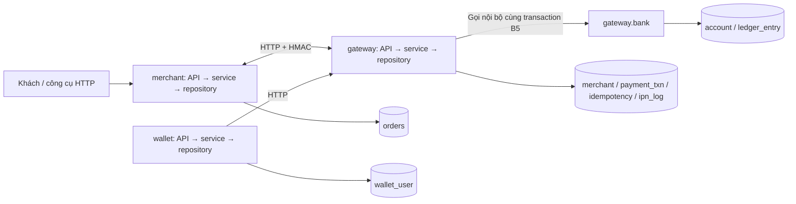
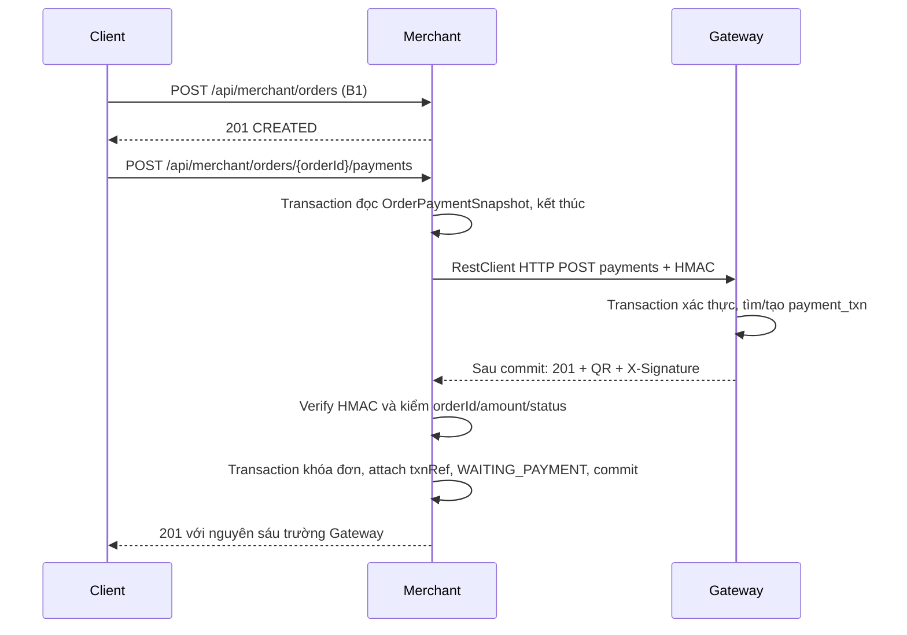

# Phân tích và thiết kế — B1, B2, B3

Tài liệu gốc: [bai-tap-luong-thanh-toan-qr.md](../bai-tap-luong-thanh-toan-qr.md).
Khi có khác biệt, quy tắc nghiệp vụ, API, mã lỗi và kiểm thử trong đề được ưu tiên.
Tài liệu này phân tích B1–B8; code hiện tại thực hiện B1, B2 và B3. Phần B4–B8 bên dưới
vẫn là thiết kế cho các giai đoạn sau, chưa có API hay nghiệp vụ tương ứng.
Kết quả thực tế và giới hạn kiểm chứng nằm ở [báo cáo B2](phase2-report.md) và
[báo cáo B3](phase3-report.md).

## 1. Quan hệ B1–B8

| Bước | Trách nhiệm và dữ liệu | Phụ thuộc / ranh giới |
|---|---|---|
| B1 | Merchant kiểm tra input, lưu `orders` ở `CREATED`, trả 201 | Chưa tạo giao dịch, QR hay gọi Gateway |
| B2 | Merchant ký yêu cầu; Gateway xác thực, tạo `payment_txn` ở `PENDING`, sinh QR | Merchant → Gateway qua HTTP. Sau phản hồi, Merchant lưu `txnRef`, đổi `WAITING_PAYMENT` trong transaction riêng |
| B3 | Wallet kiểm TLV, CRC, lấy txnRef, hỏi dữ liệu thật, so amount và hạn | Wallet → Gateway qua HTTP; không tin số tiền hay trạng thái từ QR |
| B4 | Wallet kiểm BCrypt PIN, bộ đếm sai và thời gian khóa; chuyển yêu cầu confirm | Wallet → Gateway qua HTTP với requestId UUID giữ nguyên khi retry |
| B5 | Gateway bảo vệ idempotency, khóa giao dịch, kiểm trạng thái/hạn/amount và chuyển tiền | Bank là `gateway.bank`, gọi nội bộ cùng transaction; account, ledger, txn và kết quả idempotency commit cùng nhau |
| B6 | Sau commit Gateway gửi IPN có chữ ký; Merchant xác thực và cập nhật đơn | HTTP, transaction Merchant riêng. Gửi lại có giới hạn; Merchant chống cập nhật lặp |
| B7 | Tra cứu Gateway, xem đơn Merchant; job đánh dấu hết hạn mỗi phút | Tra cứu Merchant → Gateway có HMAC; không suy đoán thành công khi HTTP timeout |
| B8 | Gateway xuất các giao dịch thành công trong ngày; Merchant đối chiếu hai tập | HTTP có HMAC; chỉ sửa missingInMerchant sau khi tra cứu B7 xác nhận |



Một ứng dụng Java 21 / Spring Boot 3.5.16 / Maven 3.9.16 / H2, một datasource và
một transaction manager. Chọn Boot 3.5 để dùng Spring MVC, Jackson 2 và JUnit 5 quen
thuộc với bài học. Java 21 nằm trong dải hỗ trợ của
[Spring Boot 3.5](https://docs.spring.io/spring-boot/3.5/system-requirements.html).
[Maven Wrapper](https://maven.apache.org/tools/wrapper/) cố định phiên bản Maven,
có checksum SHA-256 cho archive tải về.

Các package sở hữu controller, DTO, domain, repository và HTTP client của mình.
Không import service, repository, entity hay DTO nội bộ từ hai package còn lại.
`common` chỉ chứa hạ tầng: Clock, HTTP builder, JSON, HMAC, error envelope; không chứa
service nghiệp vụ hoặc repository dùng chung. Bank thuộc Gateway nên được phép gọi
nội bộ; không dựng HTTP Bank vì sẽ phá vỡ tính nguyên tử B5.
Chưa thêm broker, cache, service discovery, OAuth, frontend hoặc thư viện kiến trúc.

## 2. Mô hình dữ liệu

Đã tạo `orders`, `merchant`, `payment_txn`, sequence `merchant_order_seq` và
`gateway_txn_seq`. `data.sql` nạp MC001 nếu thiếu, không ghi đè registry đã có.
Account, ledger, Wallet và IPN chưa có DDL/entity/seed.

| Bảng / chủ sở hữu | Khóa, cột chính và quan hệ dự kiến |
|---|---|
| `orders` / Merchant — đã tạo | PK `order_id`; merchant_id; BIGINT amount; VARCHAR(19) description; status; nullable UNIQUE txn_ref; created_at; nullable paid_at; version cho optimistic locking |
| `merchant` / Gateway — đã tạo | PK merchant_id; name, city, mcc, secret_key, ipn_url; account_no hiện là giá trị, chưa FK vì Bank chưa triển khai |
| `payment_txn` / Gateway — đã tạo | PK txn_ref; merchant_id FK → merchant; UNIQUE(merchant_id, order_id); amount, description, status, qr_string, expire_at; nullable payer_account, UNIQUE bank_ref, fail_reason, paid_at; created_at và version. FK account và index tra cứu/hết hạn sẽ thêm khi có B5/B7/B8 |
| `account` / Bank trong Gateway | PK account_no; owner_name; balance BIGINT CHECK balance >= 0; version |
| `ledger_entry` / Bank | PK id; bank_ref; account_no FK → account; direction DEBIT/CREDIT; amount > 0; created_at; UNIQUE(bank_ref, direction) để không lặp bút toán |
| `wallet_user` / Wallet | PK user_id; full_name; account_no tham chiếu logic; pin_hash BCrypt; bổ sung failed_pin_attempts, pin_locked_until để khóa 15 phút bền vững |
| `ipn_log` / Gateway | PK id; txn_ref FK → payment_txn; attempt, request_body, response_code, sent_at; UNIQUE(txn_ref, attempt) |
| `idempotency` / Gateway | PK request_id; txn_ref FK → payment_txn; response_body, created_at; bổ sung fingerprint của txnRef/payerAccount/amount và HTTP status để phát hiện tái sử dụng sai khóa |

Quan hệ qua ranh giới thành phần là tham chiếu bằng giá trị, không phải JPA association
hoặc FK: orders.merchant_id/order_id/txn_ref và wallet_user.account_no. Merchant không
đọc bảng merchant của Gateway để tạo đơn B1; MC001 là cấu hình cục bộ tin cậy.
Trong Gateway được dùng FK vì các bảng cùng chủ sở hữu và chung transaction với Bank.

Tiền luôn là `long`/BIGINT VND. Mốc thời gian lưu `Instant`/TIMESTAMP WITH TIME ZONE;
API xuất ISO-8601 với offset +07:00, ngày nghiệp vụ và QR dùng Asia/Ho_Chi_Minh.
Clock được inject, test không phải chờ thời gian thực.

`schema.sql` tạo bảng bằng IF NOT EXISTS; Hibernate `validate`, không dùng create-drop
trên dev. H2 dev dùng file `data/qr-payment` với `WRITE_DELAY=0` để đồng bộ ghi file
khi commit, test dùng memory và dọn dữ liệu từng test. Phép thử dừng tiến trình ngay
sau HTTP 201 phát hiện chế độ ghi trễ mặc định có thể mất đơn vừa commit, nên chọn
đồng bộ cho bài tập ưu tiên dữ liệu. Xem [SET WRITE_DELAY của H2](https://h2database.com/html/commands.html#set_write_delay).
Thay schema ở các giai đoạn sau cần script thay đổi rõ ràng; IF NOT EXISTS không tự
nâng cấp một bảng cũ. Chưa cần thêm Flyway cho một phiên bản schema của bài tập này.

## 3. Transaction, concurrency và HTTP

- **B1 đã triển khai:** service `@Transactional`; cấp ID từ sequence DB, lưu đơn,
  commit trước khi controller gửi 201. PK, CHECK amount/description/status và UNIQUE
  txn_ref bảo vệ thêm ở DB. Không dùng timestamp/mã đếm RAM hoặc count()+1 làm ID.
  `ORD` + ngày yyyyMMdd + sequence toàn cục đệm tối thiểu ba chữ số; không reset mỗi
  ngày, không yêu cầu liên tục, chấp nhận khoảng trống khi rollback/khởi động lại do
  sequence cache. `@Version` chuẩn
  bị cho cập nhật đồng thời. B2 cập nhật đơn qua khóa bi quan trong transaction ngắn.
- **B2 đã triển khai:** kiểm merchant, chữ ký và validation; UNIQUE(merchant_id, order_id)
  là tuyến bảo vệ cuối khi tạo đồng thời. Nếu insert tranh chấp, rollback transaction
  đó rồi đọc giao dịch thắng trong transaction mới, tránh dùng transaction đã lỗi.
  Cùng orderId/PENDING cùng amount trả giao dịch cũ, giữ nguyên QR và hạn; khác amount
  trả đúng 409 ORDER_CONFLICT. Không tự tạo giao dịch thứ hai cho đơn đã terminal.
- **B5 dự kiến:** READ_COMMITTED + PESSIMISTIC_WRITE payment_txn; khóa hai account
  theo account_no tăng dần, kể cả hai txn khác nhau cùng sử dụng một tài khoản.
  Bank dùng propagation MANDATORY để không vô tình chạy ngoài transaction confirm.
  Không dùng REQUIRES_NEW cho chuyển tiền. Có version account như đề, khóa bi quan
  là cơ chế chính; không retry ghi tiền mù quáng khi gặp optimistic conflict.
- Tra idempotency đầu tiên, khóa payment_txn rồi tra lại requestId để request trùng
  đang chờ thấy kết quả đã commit. UNIQUE request_id còn bảo vệ trường hợp cùng khóa
  được dùng cho hai txn khác nhau: giao dịch thua phải rollback toàn bộ, sau đó đọc
  kết quả trong transaction mới và kiểm fingerprint. Không để exception constraint
  bị nuốt rồi commit phần tiền. Dùng outcome để trả lỗi nghiệp vụ hết hạn sau commit,
  tránh throw RuntimeException làm rollback mất thay đổi EXPIRED.
- Thiếu số dư trả outcome FAILED và lưu kết quả idempotency cùng transaction. Lỗi hạ
  tầng bất ngờ khi cập nhật account/ledger phải rollback tất cả; không catch exception
  rồi commit nửa lần chuyển tiền. Nếu cần ghi FAILED do Bank lỗi, chỉ thực hiện sau
  khi chắc chắn toàn bộ chuyển tiền đã rollback, trong transaction xử lý riêng.
- B5 phải test tổng số dư không đổi, đúng cặp ledger DEBIT/CREDIT, tối đa một bank_ref
  cho mỗi txnRef, replay giống kết quả gốc và tranh chấp hai requestId khác nhau.
- HTTP qua `RestClient`: connect timeout 3s, read timeout 5s, không tự follow redirect.
  B1 chưa phát sinh HTTP liên thành phần. B2 đã dùng RestClient, B4 là dự kiến.
  Chỉ retry với khóa nghiệp vụ giữ nguyên;
  timeout không đồng nghĩa thất bại thanh toán. Không giữ transaction/khóa DB khi gọi
  HTTP. Merchant gọi Gateway xong mới cập nhật local, có thể khôi phục qua replay/B7.

## 4. HMAC, QR đã triển khai; PIN, IPN và đối soát là dự kiến

**HMAC B2 đã triển khai:** dùng UTF-8; bỏ signature; sort tên trường tăng dần; nối key=value bằng &,
không URL-encode, không đổi khoảng trắng hay format timestamp trong lúc verify;
HMAC-SHA256 qua `javax.crypto.Mac`, lowercase hex. Verify hex hợp lệ rồi so byte bằng
`MessageDigest.isEqual`. Các trường null tùy chọn được bỏ khỏi cả JSON gửi đi và
canonical string. Không log PIN, secret hoặc signature. Không serialize entity để ký.
Merchant chỉ xác minh với secret cục bộ; Gateway dùng secret của merchant đăng ký.
Dev seed secret là dữ liệu giả lập của đề, không dùng làm secret triển khai thật.

**QR B2 đã triển khai:** buildTlv length tính theo ký tự, hai chữ số, reject value >99; giữ nguyên
tất cả tag, template và giá trị của đề. Tag62/05 = 01 + yyMMddHHmm của expireAt +
txnRef; tag62/08 tối đa 19 ASCII; tag62/09=M. CRC-16/CCITT-FALSE với poly 0x1021,
init 0xFFFF, refin/refout=false, xorout=0; vector 123456789 → 29B1; tính UTF-8 trên
toàn payload bao gồm 6304 rồi append bốn ký tự hex. CRC chỉ phát hiện lỗi, không
xác thực người tạo. B3 parse xong phải hỏi Gateway và so amount thật trước khi trả
thông tin cho khách. Đã tìm thấy project gốc ở `../qr-parser/qr-parser`, sao chép
pom và main source không chỉnh sửa vào `.build/` để build trong vùng được ghi.
`QrParserCompatibilityIT` đã gọi API project gốc với QR sinh từ Gateway, type 04:
HTTP 200, status VALID, CRC VALID. Không dùng parser tự viết để xác nhận tương thích.

**PIN:** Wallet dùng BCrypt, không đưa PIN sang Gateway; khóa user khi cập nhật số lần
sai để hai request không vượt bộ đếm. Lần sai thứ ba trả 423 PIN_LOCKED, khóa 15 phút;
thành công hoặc hết thời gian khóa reset bộ đếm theo quy tắc sẽ ghi rõ ở B4.
Chưa có wallet_user, PIN hash hoặc tài khoản ngân hàng trong giai đoạn 1.

**IPN:** không HTTP trong transaction B5. Dự kiến tạo một bản ghi công việc IPN bền
vững cùng transaction kết quả; sau commit worker quét/gửi. Có thể dùng một bảng nhỏ
ipn_delivery (txn_ref UNIQUE, attempt_count, next_attempt_at, state, lease_until) để
tránh mất thông báo khi tiến trình dừng giữa commit và dispatch; không cần broker.
ipn_log chỉ là lịch sử lần gửi, không thay thế trạng thái công việc. Khi thực hiện B6,
worker claim bằng khóa DB rồi thả transaction trước HTTP, lưu log và lịch retry trong
transaction ngắn; lease cho phép phục hồi sau crash. Merchant kiểm lần lượt chữ ký,
đơn, amount, trạng thái như bảng đề; khóa đơn khi cập nhật để chỉ một lần trả 00,
lần lặp trả 02. Gateway dừng khi code 00/02, ghi cả timeout và HTTP lỗi vào ipn_log.

**Đối soát:** danh sách SUCCESS theo paid_at trong khoảng [đầu ngày +07, đầu ngày kế
tiếp +07), cộng long; Merchant lấy snapshot local và dữ liệu Gateway qua HTTP ngoài
transaction ghi. Map theo txnRef, phân biệt missingInMerchant/missingInGateway/
amountMismatch; amountMismatch không đồng thời đếm matched. Chưa tự sửa dữ liệu trong
API báo cáo; nếu bật sửa missingInMerchant, phải verify B7 có HMAC và cập nhật có khóa.

## 5. Điểm chưa rõ và quyết định

| Điểm trong đề | Quyết định / trạng thái |
|---|---|
| Ví dụ B1 mô tả dài hơn 19 | Quy tắc 1–19 ưu tiên; ví dụ gốc bị trả INVALID_DESCRIPTION. Demo dùng `Thanh toan ao thun` |
| Chữ không dấu, số, khoảng trắng chưa nêu tập ký tự | ASCII A–Z/a–z/0–9 và dấu cách U+0020; không tab/newline/Unicode; chuỗi chỉ dấu cách là rỗng; không trim hoặc sửa input |
| JSON số thực hoặc chuỗi số có thể bị Jackson ép thành Long | Reject cả 55000.0, 1e3, "55000", boolean, overflow; không cắt phần lẻ. description không được ép từ số/boolean |
| Hai trường B1 cùng sai | Validation báo INVALID_AMOUNT trước; nếu lỗi kiểu xảy ra khi parse, báo trường không parse được |
| JSON hỏng/không body/lỗi máy chủ chưa có mã | Bổ sung mã kỹ thuật INVALID_REQUEST (HTTP 400 hoặc status HTTP tương ứng) và INTERNAL_ERROR (500), cùng envelope; không đổi hai mã nghiệp vụ B1, không lộ dữ liệu/stacktrace |
| Định dạng orderId là ví dụ, không có thuật toán bắt buộc | ORD + ngày nghiệp vụ + sequence DB tối thiểu 3 số, PK bảo vệ; không đặt giới hạn 999 đơn/ngày |
| “Mọi thao tác ghi idempotent” nhưng B1 không có khóa client | Giữ đúng API B1, không thêm body/header. Hai POST có amount/description giống nhau là hai đơn. Không thể phân biệt retry với mua hàng mới; không dùng hash body để gộp đơn. Đây là giới hạn hợp đồng gốc; muốn retry B1 an toàn phải thống nhất thêm client request key ở một thay đổi yêu cầu riêng. B2/B5 áp dụng đầy đủ khóa orderId/requestId của đề |
| Cách Merchant kích hoạt B2 chưa có endpoint | Đã chọn POST /api/merchant/orders/{orderId}/payments, body chỉ expireMinutes. B1 giữ nguyên CREATED; amount/description/merchantId lấy từ DB, trường lạ bị từ chối |
| B2 cùng orderId/PENDING nhưng đổi description/hạn | Nếu amount không đổi, ưu tiên quy tắc trả đúng txn cũ; không sửa payload/QR/hạn. Với trạng thái terminal không tạo txn mới, dự kiến trả trạng thái txn hiện có |
| B3 nói quá hạn → TXN_NOT_PAYABLE, bảng lỗi và test #8 dùng TXN_EXPIRED | B3 hiện dùng TXN_EXPIRED khi trạng thái EXPIRED hoặc PENDING đến/quá expireAt; terminal khác dùng TXN_NOT_PAYABLE. B5/test #8 vẫn là thiết kế tương lai |
| Cùng requestId nhưng khác txn/account/amount | Không thực hiện lại, kiểm fingerprint; cần chốt mã lỗi cho việc sử dụng sai khóa khi triển khai B5 vì đề chưa có mã dành cho trường hợp này |
| Chữ ký response, query GET chưa minh họa | Quy tắc mọi tin Merchant–Gateway có HMAC: request GET ký merchantId + txnRef, reconciliation ký date + merchantId, đặt ở X-Signature; response ký toàn bộ JSON, đặt ở X-Signature để giữ nguyên JSON đề. Với giá trị array/object của B8, dùng JSON compact UTF-8, sort key đệ quy, giữ thứ tự array; Gateway sort transactions theo txnRef trước khi tạo response. Hai bên cần test vector chung ở B8; không tự bỏ ký response |
| Wallet gọi GET Gateway trong B3 nhưng B7 nêu header Merchant | GET hiện phân biệt bằng credential đã xác thực: Wallet dùng Bearer token riêng, chỉ projection xác nhận; Merchant bắt buộc HMAC và quyền sở hữu. Header Merchant thiếu/sai/mixed không fallback Wallet. Không dùng query caller hoặc header vai trò tự khai để bỏ qua HMAC |
| “3 lần” IPN nhưng liệt kê 3 khoảng chờ | Chọn tổng 3 lần gửi, chờ lần lượt 10s, 30s, 60s trước mỗi lần thử (mốc sớm nhất sau commit +10s, +40s, +100s, chưa kể thời gian HTTP); không gửi lần thứ tư. Có cấu hình rút ngắn trong test. Đáp ứng kịch bản #9 ba dòng log; ghi rõ trước B6 |
| Dữ liệu mẫu U002 thiếu PIN và full_name | Seed ở B4/B5; chọn tên mô tả và PIN giả lập 123456 cho U002, BCrypt khi lưu, ghi rõ seed. Chưa seed các thành phần ngoài B1 |
| Chưa chỉ rõ ngày đối soát theo createdAt hay paidAt | Dùng ngày paidAt vì đối soát giao dịch thành công; múi giờ +07:00, interval nửa mở |

## 6. B2 đã triển khai: các ranh giới transaction



- `MerchantPaymentService` và `GatewayPaymentService` dùng propagation NEVER, tránh
  caller vô tình bao toàn bộ điều phối/HTTP trong transaction. Transaction nằm trong
  bean riêng: `MerchantPaymentStore` và `PaymentCreationTransaction`.
- Merchant chỉ nhận expireMinutes từ client, từ chối trường lạ. Snapshot lấy
  orderId/merchantId/amount/description từ DB; không đọc registry Gateway hoặc import
  DTO/entity/repository của Gateway. DTO HTTP ở Merchant và Gateway là riêng biệt.
- Unique `(merchant_id, order_id)` chặn cả hai request chưa thấy row lúc đọc. Insert
  thua rollback; service ngoài transaction đọc winner qua transaction mới, so amount
  để replay hoặc trả 409 ORDER_CONFLICT. Không dùng synchronized hoặc cache RAM.
- Merchant attach dùng SELECT FOR UPDATE và chỉ CREATED → WAITING_PAYMENT;
  WAITING_PAYMENT cùng txnRef là no-op; ref khác/trạng thái khác trả ORDER_CONFLICT.
- Không ghi trạng thái trung gian kiểu “đang gọi HTTP” vào orders. Mất response, lỗi
  verify hoặc attach rollback để đơn còn CREATED; retry cùng orderId lấy đúng txn cũ.
  Không có tự động retry nền hoặc cơ chế tạo lại B1. Cơ chế này cũng xử lý crash giữa
  hai commit, miễn client tiếp tục cùng orderId và giao dịch còn PENDING.
- Gateway trả 201 cho cả tạo và replay; giữ nguyên QR/hạn/description cũ nếu amount
  không đổi. Chưa thực hiện job hết hạn, chuyển trạng thái thanh toán hoặc tạo lại
  giao dịch terminal. Các enum/cột cho giai đoạn sau chưa có nghiệp vụ thực thi.

## 7. Chi tiết hợp đồng B2 và giả định bổ sung

- `txnRef = TX` + sequence 8 chữ số. Sequence MAXVALUE 99999999, NO CYCLE, không reset
  khi restart. Tag62/05 có 22 ký tự, nằm trong giới hạn 25 của Type04 gốc. Chấp nhận
  sequence gap khi rollback/restart; hết miền sequence thì thất bại, không quay vòng.
- expireAt lấy Clock + expireMinutes, độ chính xác giây; QR biểu diễn hạn đến phút
  `yyMMddHHmm` đúng đề, không dùng mốc QR để cập nhật dữ liệu Gateway. Merchant giữ
  nguyên offset +07 khi deserialize/serialize, không tự đổi expireAt thành UTC.
- merchantId chỉ ASCII chữ/số tối đa 13 (giới hạn tag26/01); orderId ASCII chữ/số,
  `_`/`-`, tối đa 32. Reject ký tự phân cách `&`/`=` trong identifier để tránh nhập
  nhằng canonicalization. Body Gateway có trường lạ bị reject thay vì bỏ khỏi HMAC.
- Request JSON đúng kiểu được validate trước merchant lookup/HMAC; amount ưu tiên
  trước description rồi expireMinutes. Merchant lookup trước kiểm signature như
  quy tắc 404 của đề. Signature thiếu/sai/không lowercase hex 64 ký tự → 401.
- Bổ sung INVALID_EXPIRE_MINUTES (400) vì đề chưa đặt mã cho hạn không hợp lệ;
  ORDER_NOT_FOUND (404) cho endpoint Merchant mới; GATEWAY_UNAVAILABLE và
  INVALID_GATEWAY_RESPONSE (502) cho kết quả HTTP không xác định/không đáng tin.
  Giữ nguyên mã nghiệp vụ B1/B2 đã quy định và envelope errorCode/message/timestamp.
- Gateway ký response JSON bằng secret của merchant trong header X-Signature,
  không thêm field vào sáu trường đề bài. Ký cả error envelope nếu đã parse được
  merchantId đăng ký; unknown merchant hoặc JSON chưa parse được không có key để
  chọn, nên response này không có chữ ký. Merchant không phản chiếu nội dung lỗi
  chưa xác thực và không dùng chúng để thay đổi đơn. Error xác thực được chỉ chuyển
  tiếp mã whitelist với HTTP tương ứng, không phản chiếu message Gateway tùy ý.
- HMAC hiện hỗ trợ các giá trị scalar của B2, null optional bỏ qua. Array/object
  canonical JSON của B8 vẫn là thiết kế tương lai. DTO request và config có secret
  được redact toString; giảm log Spring web/HTTP/SQL-init để không log signature hay
  literal secret trong seed. Không tạo endpoint hiển thị registry/secret.
- Seed MC001 theo đề, account_no chỉ metadata, không tạo account hay chuyển tiền.
  `schema.sql` B2 chỉ bổ sung bảng/sequence mới; không sửa orders. Smoke test JAR đã
  nâng cấp bản sao file H2 B1 có 2 đơn, giữ dữ liệu cũ, tạo/replay một payment mới.

## 8. Kiểm thử và phạm vi dừng

Đã chạy 118 test: 66 B1 và 52 B2, 0 failure/error/skipped; có kiểm chứng API gốc
qr-parser Type04 qua HTTP, không chỉ so TLV bằng code tự viết. Test bao phủ cả hai
request đồng thời khác amount (một 201, một 409), hai request Merchant cùng đơn,
response sai HMAC/JSON hỏng, mất response sau Gateway commit, attach rollback và retry.
Xem lệnh và evidence trong [phase2-report.md](phase2-report.md).

Mốc B2 ở trên giữ nguyên kết quả 118 test. Kết quả mở rộng B3 ở báo cáo B3.

## 9. B3: quét QR và GET có phân quyền

```mermaid
sequenceDiagram
    participant C as Client
    participant W as Wallet
    participant G as Gateway
    C->>W: POST /api/wallet/scan (userId, qrString)
    W->>W: Parse TLV, required tags, 62/05 và CRC
    W->>G: RestClient GET /payments/{txnRef}, credential Wallet
    G->>G: Xác thực quyền đọc, transaction chỉ đọc payment + merchant
    G-->>W: Projection xác nhận + X-Signature, no-store
    W->>W: Verify HMAC/txnRef; so amount; kiểm status và Clock
    W-->>C: 200: thông tin thật từ Gateway hoặc error envelope
```

- Wallet sở hữu parser và HTTP DTO riêng, không import Gateway. B3 không mở transaction
  khi HTTP, không có bảng mới, không ghi DB và không chuyển PENDING sang EXPIRED.
  CRC chuyển thành thuật toán chung trong common/qr; facade Gateway giữ nguyên API
  B2 để tái sử dụng đúng thuật toán mà không import nghiệp vụ qua ranh giới.
- Parser nhỏ chỉ phục vụ cấu trúc B2: giới hạn 512 ký tự UTF-16, header tag/length là
  hai số ASCII, length tính code point, đọc hết payload/template 26/62, reject tag lặp,
  thiếu tag, value cắt ngắn, control character/unpaired surrogate; 00 đầu, 63 cuối,
  6304 + bốn hex. Không trim dữ liệu. Tag lạ hợp lệ về TLV có thể tồn tại.
- Bắt buộc các tag của B2 và 26/00,26/01,62/05,62/08,62/09; kiểm các giá trị cố định
  của QR động VND/VN/GUID. 62/05 đúng prefix 01 + yyMMddHHmm hợp lệ + TX và 8 số như
  B2 hiện sinh. Thế kỷ 20yy chỉ dùng kiểm ngày hợp lệ, không dùng làm hạn thanh toán.
  Hạn quyết định là expireAt trả về từ Gateway.
- CRC sai sau khi cấu trúc đã hợp lệ → CRC_MISMATCH; cấu trúc/trường sai → INVALID_QR.
  Sau lookup, ưu tiên AMOUNT_MISMATCH trước trạng thái/hạn, đúng thứ tự đề. Trạng thái
  terminal khác EXPIRED → TXN_NOT_PAYABLE; PENDING tại expireAt đã không còn payable.
- GET cùng đường dẫn nhưng hai hợp đồng theo credential: Wallet Bearer credential chỉ
  nhận projection 8 trường, không orderId/bankRef/tài khoản; Merchant cặp header HMAC
  nhận các trường B7, chỉ khi merchantId sở hữu giao dịch. Không có nhánh anonymous.
  Chữ ký GET Merchant là canonical merchantId + txnRef; không phụ thuộc caller tự khai.
- Nếu có bất kỳ header Merchant: bắt buộc đúng một header mỗi loại và không trộn
  Authorization. Sai/missing/duplicate/mixed → 401 INVALID_SIGNATURE, không thử lại
  nhánh Wallet. Merchant hợp lệ nhưng khác chủ sở hữu → 404 TXN_NOT_FOUND.
- Sau xác thực, ký cả thành công và lỗi lookup bằng secret tương ứng, no-store.
  Wallet verify bằng credential riêng của mình, không giữ secret Merchant. Kết nối
  mất/5xx → 502 GATEWAY_UNAVAILABLE; response hỏng/sai HMAC/txnRef → 502
  INVALID_GATEWAY_RESPONSE; chỉ 404 TXN_NOT_FOUND có xác thực được chuyển nguyên mã.
- Credential mẫu dev được cấu hình qua QR_WALLET_READ_TOKEN hai phía; không đưa vào
  QR/body scan, không log. Đây là credential service nội bộ, không phải xác thực U001.
  userId được validate hình thức, chưa có user registry/PIN hay wallet_user ở B3.

Kết quả B3: 185 test PASS (118 cũ + 67 mới), không failure/error/skipped. Chưa có
full flow B1–B8; các ca CRC sửa tên và sửa amount rồi tính lại CRC ở B3 đã được test.

Dừng B3: GET chỉ là nền tảng cần cho B3 và bảo vệ sẵn cho B7; chưa có workflow B7,
job hết hạn, B4 xác nhận/PIN, Bank, IPN, đối soát hoặc hoàn tiền.
