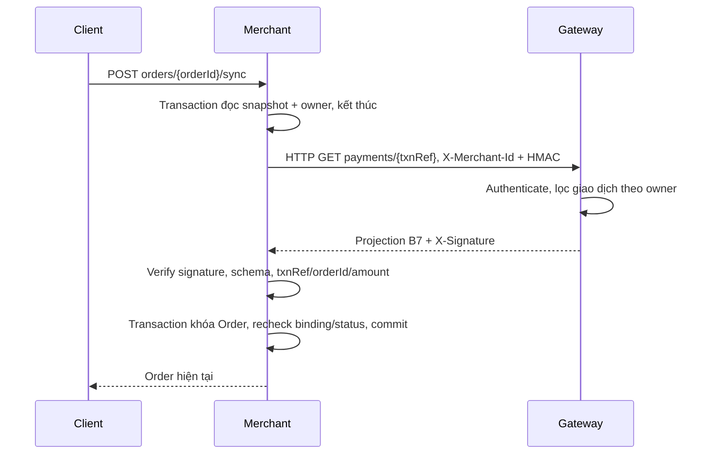

# Báo cáo B7 — tra cứu trạng thái và xử lý hết hạn

Ngày kiểm chứng **2026-11-13**, múi giờ +07:00. Bắt đầu từ Git sạch **7ed69fe**
(B6); giữ nguyên lịch sử và hợp đồng B1–B6. Nguồn yêu cầu ưu tiên là
[đề chính thức](../bai-tap-luong-thanh-toan-qr.md) và yêu cầu B7 hiện tại.
Dừng tại B7; chưa triển khai B8, đối soát hoặc hoàn tiền.

## API và luồng đồng bộ

| API | Hành vi |
|---|---|
| `GET /api/gateway/payments/{txnRef}` | Giữ nguyên Gateway API B3; Merchant dùng X-Merchant-Id/X-Signature, Wallet credential riêng |
| `GET /api/merchant/orders/{orderId}` | Mới: chỉ đọc Order thuộc Merchant local, không HTTP/ghi DB |
| `POST /api/merchant/orders/{orderId}/sync` | Mới: không cần body; khi WAITING_PAYMENT gọi HTTP Gateway, xác thực và cập nhật có khóa |

GET Gateway đã có đủ trường, HMAC request, quyền sở hữu, ký response và projection
riêng từ B3, nên không tạo implementation trùng lặp hoặc đổi DTO Gateway.
Merchant ký request canonical `merchantId=MC001&txnRef=TX00000001` bằng secret
MC001. Mẫu signature cho đúng hai giá trị này và secret-mc001:
`6da077da180daf4aa480006c8bfa0287ab82ad25fb6e1e2785c7c91acaaffdec`.
Nếu txnRef khác, bắt buộc ký lại. Không có nhánh Merchant anonymous/fallback Wallet.

Response Gateway SUCCESS theo đề (giá trị chỉ minh họa):

```json
{
  "txnRef":"TX00000001","orderId":"ORD20261113001","amount":55000,
  "status":"SUCCESS","bankRef":"BK20261113000001",
  "createdAt":"2026-11-13T10:00:00+07:00","paidAt":"2026-11-13T10:00:30+07:00"
}
```

Gateway ký JSON trong header X-Signature; bankRef/paidAt chưa có thì bỏ như B3.
Wallet vẫn chỉ có tám trường projection xác nhận, không orderId/bankRef/tài khoản/
createdAt/paidAt hoặc secret. Lookup đã xác thực cả thành công và lỗi có no-store.

GET Merchant và POST sync trả HTTP 200 cùng cấu trúc:

```json
{
  "orderId":"ORD20261113001","merchantId":"MC001","amount":55000,
  "description":"Ao thun","status":"PAID","txnRef":"TX00000001",
  "createdAt":"2026-11-13T10:00:00+07:00","paidAt":"2026-11-13T10:00:30+07:00"
}
```

CREATED chưa thanh toán không có txnRef; trạng thái chưa trả tiền không có paidAt.
Đề chưa quy định endpoint kích hoạt đồng bộ: chọn POST sync riêng vì có thể ghi DB;
GET luôn chỉ đọc, không gây HTTP ngoài dự kiến. Sync lặp là no-op nếu đơn terminal.



GatewayPaymentClient được dùng lại cho B2/B7, helper verify HMAC chung. B7 có DTO
GatewayPaymentStatus riêng của Merchant, không import Gateway entity/service/repo.
Chỉ nhận một header response signature; HMAC xác thực trên JSON trước deserialize.
Sau đó kiểm schema whitelist, txnRef/orderId/amount khớp snapshot đã lưu, createdAt
và status hợp lệ; SUCCESS bắt buộc bankRef/paidAt, paidAt không trước createdAt.
Các trạng thái khác không mang bankRef/paidAt. Không tin trường không được xác thực.

Response B7 không có merchantId theo đề; ownership được bảo đảm bởi Gateway lọc
theo header/key Merchant đã xác thực, Merchant verify bằng key local và recheck
owner/binding đơn. Không thêm field hoặc bỏ kiểm quyền để suy diễn từ txnRef.

MerchantOrderLookupService NEVER; load/apply là transaction riêng trong store.
Chỉ WAITING_PAYMENT cập nhật SUCCESS → PAID, FAILED → PAYMENT_FAILED, EXPIRED →
EXPIRED. PENDING/PROCESSING giữ nguyên. PAID/PAYMENT_FAILED/EXPIRED và CREATED
không bị tự đổi hoặc gọi HTTP. Sync và IPN dùng cùng findForUpdate; sau HTTP đọc lại
Order trước cập nhật, nên IPN thắng trước hoặc response PENDING cũ không đảo kết quả.
Order.confirmPayment được tái sử dụng, chỉ bổ sung Order.expire cho cạnh EXPIRED.

| Lỗi | HTTP / mã |
|---|---|
| Không có đơn/không thuộc Merchant local | 404 ORDER_NOT_FOUND |
| Gateway 404 TXN_NOT_FOUND có chữ ký hợp lệ | 404 TXN_NOT_FOUND |
| Mất phản hồi, timeout trước/sau headers, HTTP 5xx | 502 GATEWAY_UNAVAILABLE |
| Response sai/thiếu chữ ký, schema, binding hoặc không đúng protocol | 502 INVALID_GATEWAY_RESPONSE |
| Binding local bị thay giữa snapshot và apply | 409 ORDER_CONFLICT |

Các lỗi dùng envelope errorCode/message/timestamp hiện có, không phản chiếu message
remote tùy ý, không cập nhật đơn khi chưa xác thực. Có thể gọi lại sync sau lỗi.
Không suy ra EXPIRED từ Clock Merchant hay FAILED từ timeout.

RestClient lookup dùng connect 3s/read 5s kể cả body, không redirect, giới hạn 16 KiB.
BoundedHttpRequests tách đúng factory đã dùng ở IPN B6 để tái sử dụng; transport B2
giữ nguyên. Timeout là socket read timeout, không cam kết deadline tuyệt đối nếu
peer gửi dữ liệu nhỏ giọt liên tục; body được giới hạn để tránh đọc dữ liệu quá lớn.

## Job hết hạn và cạnh tranh với B5

PaymentExpiryScheduling dùng @Scheduled fixedDelay 60000ms mặc định, tick đầu khi
scheduler sẵn sàng. Cấu hình app.gateway.expiry.enabled (true), interval-millis
(60000). Pool scheduler hai luồng để việc chờ HTTP IPN không chặn toàn bộ job hết hạn.
Test profile tắt job mặc định; test scheduler riêng bật interval 25ms.

PaymentExpiryJob NEVER lấy danh sách txnRef scalar có PENDING và expireAt <= Clock.
PaymentExpiryTransaction mở transaction riêng cho từng PK, dùng findForUpdate như
B5, đọc Clock sau khi lấy khóa, kiểm lại status/hạn rồi gọi PaymentTxn.expire/flush.
Không bulk update bỏ qua state machine hoặc @Version. Index mới (status,expire_at)
hỗ trợ chọn ứng viên; không thay schema hoặc giá trị của các bản ghi tài chính.

- Job chỉ PENDING → EXPIRED; không đổi SUCCESS/FAILED/PROCESSING hoặc PENDING chưa hạn.
- Confirm lấy khóa và kiểm trước hạn vẫn hoàn tất theo B5 dù Bank commit sau hạn;
  job chờ rồi thấy terminal và bỏ qua. Điểm quyết định là kiểm Clock sau payment lock,
  không phải lúc client bắt đầu gửi request hoặc thời điểm commit sau Bank.
- Nếu job/confirm kiểm ở hoặc sau expireAt trước, giao dịch EXPIRED và confirm từ chối.
  Hai job tranh cùng PK cũng chỉ một lần tăng version.
- Hết hạn không chuyển tiền, ghi ledger/idempotency/outbox hoặc publish PaymentCompleted;
  không tạo IPN EXPIRED vì hợp đồng B6 chỉ có SUCCESS/FAILED.
- Lỗi sau flush rollback giao dịch đó; tick sau thử lại. Các PK đã commit ở trước
  vẫn giữ EXPIRED. Restart không cần queue RAM; tick đọc lại PENDING quá hạn trong DB.
- B2 replay trực tiếp Gateway giữ cùng txnRef/QR/hạn và trả trạng thái hiện có.
  B5 replay dùng cache UUID như cũ: lỗi EXPIRED lặp trả đúng lỗi, SUCCESS đã commit
  trước đó vẫn replay SUCCESS sau hạn, không chuyển tiền hoặc tạo giao dịch mới.

## Audit IPN không lưu chữ ký

IpnAuditPayload bỏ trường signature trước khi tạo IpnLog. IpnOutbox/IpnClaim vẫn
giữ đầy đủ signed payload, gửi/retry nguyên vẹn, không ký lại hoặc sửa URL/body.

ApplicationRunner làm sạch log B6 cũ khi khởi động. Chỉ UPDATE ipn_log.request_body,
giữ nguyên ID, txnRef, attempt, sentAt/finishedAt và outcome. Không sửa account,
ledger_entry, payment_txn hoặc idempotency; không sửa outbox. @DynamicUpdate trên
IpnLog ngăn worker đang giữ entity cũ khôi phục signature khi ghi ACK đồng thời
với quá trình redaction. Test xác nhận ID/outcome/timestamps giữ nguyên khi redact;
hai transaction thật còn xác nhận ACK từ entity cũ không đưa lại signature.

Chọn đọc lịch sử audit khi khởi động vì quy mô bài tập; chưa tối ưu migration theo
batch/retention cho lượng log lớn. JSON audit lưu từ ứng dụng phải hợp lệ; dữ liệu
audit bị hỏng do sửa ngoài ứng dụng làm redaction thất bại thay vì tiếp tục giữ chữ ký.

## Kiểm thử thực tế

Lệnh đã chạy qua Maven Wrapper với JDK 21, cache trong workspace và qr-parser gốc
được khởi động trên cổng ngẫu nhiên:

```powershell
$env:JAVA_HOME = Split-Path (Split-Path (Get-Command java).Source)
$env:MAVEN_USER_HOME = Join-Path $PWD '.build\maven-user-home'
.\mvnw.cmd -B "-Dmaven.repo.local=$PWD\.build\repository" `
  "-Dtest=*Test,*IT" "-Dqr.parser.url=http://127.0.0.1:<cổng-parser>" test package
```

**291 PASS, 0 FAIL, 0 errors, 0 skipped; BUILD SUCCESS.** Maven mất **02:47**,
kết thúc **2026-11-13 10:18:24 +07:00**. JAR đóng gói thành công.

| Nhóm | Test | Failure / error / skipped |
|---|---:|---|
| Toàn bộ B1–B6 đã có, gồm cả ba IT | 244 | 0 / 0 / 0 |
| MerchantStatusHttpIntegrationTest | 36 | 0 / 0 / 0 |
| PaymentExpiryIntegrationTest | 10 | 0 / 0 / 0 |
| PaymentExpirySchedulerTest | 1 | 0 / 0 / 0 |
| **Tổng** | **291** | **0 / 0 / 0** |

Full run giữ đủ 66 test B1 và toàn bộ test B2–B6, không sửa test cũ hoặc bỏ assertion.
QrParserCompatibilityIT vẫn gọi project gốc Type04 qua HTTP; hai IT restart B5/B6
vẫn chạy production JVM với H2 file thật. Default mvnw test chọn 288 ca; lệnh full
ở trên chọn thêm ba IT, không âm thầm skip kiểm thử đặc biệt.

Evidence cục bộ: `.build/b7-final-verify.log`, `.build/b7-qr-parser-http.log` và XML
`target/surefire-reports/TEST-*.xml`. Những thư mục build không đưa vào Git.
Lần kiểm tra mới ban đầu có 4 failure/1 error do fixture spy gọi abstract method và
transaction proxy lúc setup; đã sửa fixture dùng EntityManager/khóa DB thật, không
xóa ca test. Rerun 44 ca đều PASS, sau đó thêm ba ca HTTP và full 291 ca đều PASS.

Các ca B7 quan trọng:

- GET Order local/CREATED chưa có payment, owner khác/không tồn tại; GET không HTTP/ghi DB.
- Lookup Merchant SUCCESS đúng projection/chữ ký, HMAC sai và quyền sở hữu sai;
  Wallet không nhận các trường riêng của Merchant.
- HTTP IPN 500 ba lần → EXHAUSTED, sync qua HTTP lấy SUCCESS và cập nhật PAID;
  FAILED cập nhật PAYMENT_FAILED, Gateway EXPIRED mới cập nhật Order EXPIRED.
- Response sai/mất chữ ký; sửa txnRef/orderId/amount rồi ký lại; sai kiểu, thiếu trường,
  status lạ, projection Wallet, JSON hỏng, quá 16 KiB và redirect đều bị từ chối.
- HTTP 500, drop, timeout headers và timeout body thật không đổi đơn; signed 404 được chuyển đúng.
- Stale PENDING khi IPN đã commit; IPN SUCCESS/FAILED thắng trong lúc HTTP lookup
  đang chờ; sync và IPN đồng thời chỉ cập nhật Order/version một lần.
- Clock tại chính expireAt; chỉ PENDING đến hạn đổi EXPIRED; SUCCESS/FAILED và
  PROCESSING giữ nguyên. Hai job cập nhật một PK chỉ một lần.
- Confirm và expiry cùng chạy sau hạn; confirm giữ khóa trước hạn rồi hoàn tất sau
  hạn; expiry giữ khóa trước confirm; Clock được đọc sau khi chờ khóa.
- Replay B2/B5 sau hết hạn, không tạo payment/Bank/ledger mới; invariant tổng số dư,
  cặp ledger và cache idempotency; lỗi sau flush rollback rồi tick tiếp theo thành công.
- Scheduler thật tự chạy với cấu hình 25ms, chỉ Clock nghiệp vụ được nhảy một phút.
- Audit mới/cũ không chứa signature hoặc giá trị chữ ký; outbox giữ nguyên byte,
  không đổi lịch sử/kết quả tài chính; ACK đồng thời không phục hồi chữ ký vào audit.

## File và phạm vi thay đổi

- Merchant: OrderDetails, OrderLookupController, GatewayPaymentStatus,
  MerchantOrderLookupStore/Service; thêm lookup/verify chung vào GatewayPaymentClient;
  Order.expire, tái sử dụng Order.confirmPayment và OrderRepository.findForUpdate.
- Gateway: PaymentExpiryJob/Transaction/Scheduling, query scalar trong PaymentTxnRepository.
- Audit: IpnAuditPayload, IpnLog/Repository, claim ghi payload đã redacted trong IpnJobStore.
- Common: BoundedHttpRequests dùng lại cho IPN và lookup; không đổi timeout/redirect B6.
- Config/DDL: pool scheduler 2, tắt expiry trong test profile, thêm index expiry.
- Ba lớp test B7 mới; README, architecture, báo cáo này, requests/b7.http.
- Không sửa BankTransferService, ConfirmationTransaction, API B1–B6 hoặc test B1–B6.

## Giới hạn còn lại

- Chỉ kiểm chứng H2 và HTTP/stub/process local; chưa chạy PostgreSQL hoặc deployment nhiều instance.
- Sync là thao tác chủ động, chưa có poll Merchant nền. Không tự sửa đơn terminal
  mâu thuẫn; không triển khai B8 hoặc tự đối soát dữ liệu.
- Một tick lấy danh sách scalar ứng viên, rồi transaction từng PK; ứng viên mới đến
  hạn sau snapshot chờ tick sau. Chưa tối ưu phân trang/throughput cho lượng giao dịch lớn.
- HMAC scalar/credential mẫu và giới hạn lease/giao nhận lặp B6 vẫn áp dụng.
  Không bổ sung OAuth, message broker, refund, job cleanup hoặc requeue vận hành.
